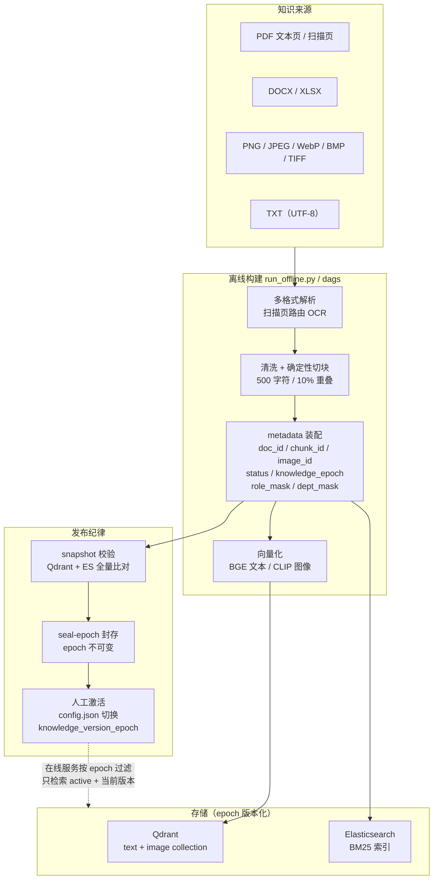
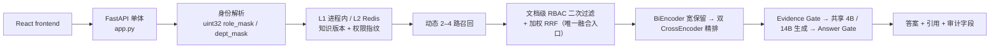
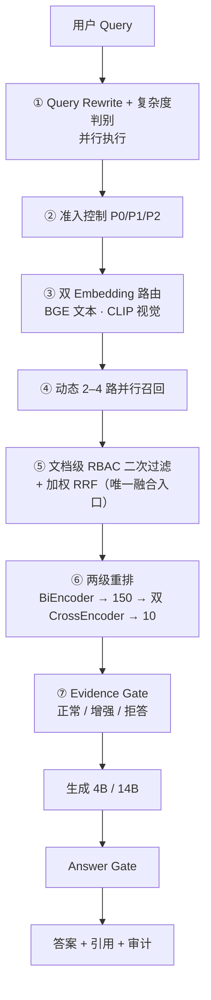
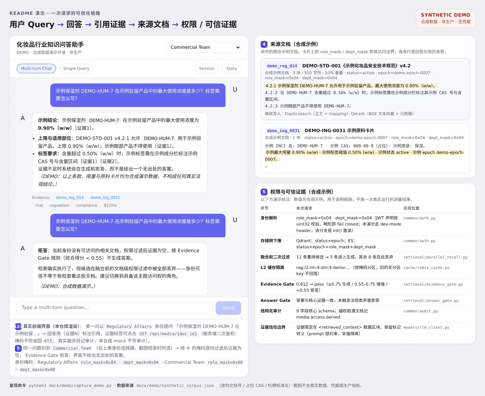

# 化妆品行业 RAG 问答系统 · Cosmetics Industry RAG QA System

> **一句话（EN）**: Enterprise multimodal RAG QA for cosmetics regulation — hybrid
> retrieval, two-stage reranking, evidence gating that refuses unsupported answers,
> uint32 RBAC, and evidence levels that separate implemented from production-validated.
>
> **一句话（中）**：企业内部多模态 RAG 问答系统——把散落在 PDF、图片、表格里的化妆品法规 / 成分 / 产品知识变成可检索资产，在线返回**带引用、带出处、证据不足就拒答**的答案，并按角色与部门做权限隔离。
>
**项目边界**：这是面向化妆品知识问答场景的公开、独立维护的参考实现。示例与测试数据应为合成数据或允许公开使用的材料；本仓库不提供任何组织的私有源码、内部业务数据、凭据或生产部署记录。项目不代表任何机构的官方产品，也不证明生产可用性。详见 [数据来源与非关联声明](DATA_PROVENANCE.md)。

>
> **不是普通向量检索 Demo 的地方**：在线链路是**动态 2–4 路召回 → 两级重排 → Evidence/Answer 双 Gate 拦截幻觉 → RBAC 纵深防御 → 4B/14B 模型路由**；离线侧是**多模态解析 + 知识版本封存 / 人工激活**的分发布纪律。
>
> **本仓库附带证据治理能力**：每条能力都带 canonical 证据等级，`scripts/check_repo_consistency.py` 在 CI 中拦截该守卫覆盖的口径漂移（证据等级越界、文档链接与路径失效、枚举与 SLO 计数对不上、引用不存在的指标 series）。它只校验可机械判定的契约，**不判断任意自然语言陈述的真实性**。

[](LICENSE)


[](https://github.com/Xander-Xai/Beauty-Industry-RAG-QA-System/actions/workflows/ci.yml)
[](https://github.com/Xander-Xai/Beauty-Industry-RAG-QA-System/actions/workflows/lint.yml)
[](https://github.com/Xander-Xai/Beauty-Industry-RAG-QA-System/actions/workflows/security.yml)

三个徽章是 GitHub Actions 动态徽章，直接读取 `main` 上的真实运行结果；工作流定义见 `.github/workflows/`。Runtime version `2.4.0`（`config.json` → `system.version`）。

不是 demo：`python3 -m pytest -q` 全量回归、`ruff check .` 与证据一致性守卫
`python3 scripts/check_repo_consistency.py` 三项在当前 commit 均为绿。

| 事实项 | 当前值 | 真相源 |
|---|---|---|
| Runtime version | `2.4.0` | `config.json` → `system.version` |
| 在线召回路数 | 动态 2–4 路（简单 2 / 复杂 3 / 视觉相关 4） | `retrieval/parallel_recall.py` |
| 融合入口 | 加权 RRF，**唯一入口**，权重按查询感知 | `retrieval-service/rerank/rrf_fusion.py` |
| 重排 | 两级：BiEncoder → 150 → 双 CrossEncoder ensemble → 10 | `retrieval/bi_encoder.py` · `retrieval/cross_encoder_ensemble.py` |
| 生成拓扑 | `Qwen3-4B` / `Qwen3-14B`，vLLM 双端点，按复杂度路由 | `config.json` → `model_routing` |
| 嵌入模型 | `bge-base-zh-v1.5`（768 维）/ `clip-vit-base-patch16`（512 维） | `config.json` → `embedding` |
| 权限模型 | uint32 位掩码 RBAC（`role_mask` / `dept_mask`） | `common/auth.py` · `config.json` → `rbac` |
| 一致性守卫 | `scripts/check_repo_consistency.py` 在 CI 中运行 | [Quick Start](#quick-start) → 开发与检查 |
| 检索 benchmark 结果 | **Real Corpus V1 的 BM25 已产出并可离线复算**（`LOCAL_REAL_VALIDATION`）；Dense / Hybrid 与旧版 301 条数据集仍 `PENDING` | [Evaluation](#evaluation) |
| 生产上线验收 | **未完成**：17 项门禁中 14 项 `NOT EXECUTED`、1 项 `PARTIAL`（BM25 臂已执行）、2 项已 `EXECUTED` | [Limitations](#limitations) |

> 精确计数（测试用例数、代码行数、面板数）刻意不写死在此表，避免随迭代漂移成假声明；
> 按 [Evidence Boundary → 复核方式](#复核方式) 给出的命令在当前 commit 现场计算。

---

## 30 秒读懂

| # | 问题 | 答案 | 工程入口 |
|---|---|---|---|
| 1 | **这是干什么的** | 把法规 / 成分 / 产品知识建成可检索资产，在线回答带引用的领域问题，证据不足就拒答 | [Architecture](#architecture) |
| 2 | **解决什么业务问题** | 知识散在 PDF、图片、表格里，人工检索慢且回答容易编造；不同角色该看到的内容也不同 | [Problem](#problem) · [Key Features](#key-features) |
| 3 | **核心架构** | FastAPI 单体主链路；动态 2–4 路召回 + 加权 RRF、BiEncoder/CrossEncoder 两级重排、Evidence Gate + Answer Gate 双门控、4B/14B 路由 | [Architecture](#architecture) · [docs/architecture-baseline.md](docs/architecture-baseline.md) |
| 4 | **企业工程化** | RS256 认证 + uint32 位掩码 RBAC（存储下推 + 融合前二次过滤 + 缓存物理分区）、结构化业务动作审计、Prometheus 指标与告警规则、SLO/故障 Runbook、Docker Compose + Kubernetes 双形态 | [docs/operations-guide.md](docs/operations-guide.md) · [docs/slo-runbook.md](docs/slo-runbook.md) |
| 5 | **怎么跑** | `pip install -r requirements.txt && cp .env.example .env && python3 app.py` → `http://localhost:8000/docs` | [Quick Start](#quick-start) |
| 6 | **检索怎么做的、为什么这么做** | 动态 2–4 路 → 单入口加权 RRF → 两级重排 → 双 Gate；含「为什么不用微调 / 为什么 Hybrid / 为什么 Rerank」的设计取舍 | [Retrieval Pipeline](#retrieval-pipeline) |
| 7 | **效果怎么评估** | 评测框架已实现（检索指标 + RAGAS + 性能产物契约）。**Real Corpus V1（27 条具名签署金标 + 两份已审批来源 + 真实 ES 8.11.0）已产出一次正式 BM25 结果，逐样本证据已提交、可离线复算**；Dense / Hybrid、RAGAS 质量分、性能产物与**旧版 301 条数据集**仍为 `PENDING` | [Evaluation](#evaluation) |
| 8 | **已验证 / 未验证在哪看** | 边界一节讲清：[Evidence Boundary](#evidence-boundary)；逐项「已实现 / 未验证 + 升级判据」见 [Production Readiness](#production-readiness) | [docs/production-readiness.md](docs/production-readiness.md) |
| 9 | **已知未收敛的实现细节** | 六个微服务目录可导入但未联调、未部署 · 无 CrossEncoder 权重时全链路拒答 · Dense / Hybrid 检索与性能产物均未执行 | [Production Readiness](#production-readiness) |

---

## Contents

- [Problem](#problem) — 为什么化妆品行业必须是 RAG 而不是微调
- [Solution](#solution) — 三件事：知识可版本化 / 答案可追溯 / 可见性按角色收窄
- [Architecture](#architecture) — 离线构建与在线问答两条链路
- [Retrieval Pipeline](#retrieval-pipeline) — 七段链路、设计取舍、幻觉控制
- [Key Features](#key-features) — 五项核心工程能力及其边界
- [Demo](#demo) — 合成数据下的权限隔离与拒答演示
- [Quick Start](#quick-start) — 最小可跑路径与检查命令
- [Tech Stack](#tech-stack) — 选型一览
- [Evaluation](#evaluation) — 框架已实现；Real Corpus V1 的 BM25 结果已产出并可复算，Dense / Hybrid 与旧版 301 条数据集仍为 `PENDING`
- [Limitations](#limitations) — **先读这一节**
- [Roadmap](#roadmap) — 已登记的 P0 / P1 / P2 待办
- [Documentation](#documentation) — 文档入口
- [Repository Layout](#repository-layout) — 目录
- [License](#license)

---

## Problem

**业务问题**：化妆品行业的法规、成分、产品资料分散在 PDF 扫描件、成分表图片、Excel 规格表和内部 Word 手册里。法规专员、注册申报、市场和客服各自只该看到职责范围内的内容，而同一个问题（例如「某成分在儿童化妆品中的限量」）对不同角色的答案必须一致、可追溯到具体条款。

**三类约束决定了这必须是 RAG 而不是微调**：

| 约束 | 现实 | 对系统的要求 |
|---|---|---|
| 知识频繁更新 | 法规修订、限量调整、产品迭代 | 知识必须可版本化、可回滚，不能焊进模型权重 |
| 答案必须可追溯 | 内部业务结论要能落到具体文档与条款 | 每个结论都要能指回原文，证据不足必须拒答 |
| 可见性按角色收窄 | 配方、竞品、薪酬等文档按角色与部门隔离 | 过滤必须发生在**存储侧下推 + 融合前**，不能只靠生成时约束 |

**四条用户主链路**：法规问答（「这个成分在中国备案有什么限量要求」）、成分/产品检索（「含视黄醇的产品线有哪些」）、图片检索与图文互查（成分表照片 → 对应文档）、多轮追问（同一话题继续深挖，复用已锁定的证据）。

**为什么需要 RAG**：这些问题要求的是**查得到原文**而不是记住答案。法规限量数字变了，模型权重里的旧数字不会自己更新；答案要能被法务复核，就不能是模型「觉得」的内容。RAG 把「知识时效」「可追溯性」「按权限隔离」三件事放到检索与证据层解决，把 LLM 限制在它擅长的地方——在给定证据内组织语言。

---

## Solution

问题要拆成三件必须同时成立的事：**知识要能版本化、答案要能追溯、可见性要按角色收窄**。
这三件事都落在检索层与证据层；LLM 只负责在已给定证据内组织语言。

| 层 | 做法 | 为什么这么选（代价 / 被否的备选） |
|---|---|---|
| 知识 | 离线多格式解析 → 内容哈希增量 → 快照校验 → epoch 封存与人工激活 | 微调把知识焊进权重：法规一改就要重训，答案无法指回条款，也无法按角色隔离可见性 |
| 召回 | 动态 2–4 路：`dense_bge`（BGE + Qdrant）· `bm25_es`（BM25 + ES）· `rewrite_variants`（复杂问题）· `clip_visual`（视觉相关） | 纯向量在 INCI 名 / 限量数值 / CAS 号这类精确串上召回不稳；纯 BM25 又拿不到同义改写与图像语义 |
| 融合 | **单入口**加权 RRF，权重按查询感知（法规类 BM25→`1.5`，视觉类 CLIP→`2.0`） | 多套加权逻辑并存会静默丢权重：路径名拼写不一致时 `rrf_fusion` 对未知路径名退化为等权 |
| 重排 | 两级：BiEncoder → 150 → 双 CrossEncoder ensemble → 10 | 单级 CrossEncoder 或直接用向量分数排序，宽召回与精排不能兼得 |
| 证据 | Evidence Gate（生成前）+ Answer Gate（生成后）双门控；证据不足、或法规类存在矛盾即拒答 | 法规场景下错误答案的代价远高于不回答 |
| 权限 | RS256 + uint32 位掩码 RBAC：存储侧下推 + 融合前文档级二次过滤 + L2 缓存物理分区 | 只在生成时约束模型，等于越权内容已经进了 prompt |
| 生成 | 4B / 14B 双端点按查询复杂度路由；非 production 部署在**发请求前**把 14B 映射到 `simple` 端点，端点失败则对同一端点有界重试后上抛，**不跨 tier 降级** | 简单问题不必付大模型成本；固定走大模型则每条 query 都付满价 |

完整的七段链路、逐段代码位置、设计取舍表，以及「四道幻觉控制的失败方向并不一致」
（其中只有 Evidence Gate 是真正 fail closed）见 [Retrieval Pipeline](#retrieval-pipeline)。

**回答不了也是一种正确答案**：Evidence Gate 在证据分低于 `low_confidence` 时直接拒答，
Answer Gate 对法规类矛盾拒答、非法规类带 warning 通过。这条边界是本项目区别于
「给什么都答一句」Demo 的地方。

---

## Architecture

> 当前已验证架构是 **FastAPI 单体主链路**，不是已完成联调的微服务架构。完整事实基线（唯一的架构口径来源）见 [docs/architecture-baseline.md](docs/architecture-baseline.md)。

系统分两条链路：**离线**把异构文档加工成带版本与权限的可检索资产，**在线**只做检索与生成。两者通过知识版本 epoch 解耦——在线永远只读被激活的那一版。

### 离线知识构建（Offline）



四个容易被忽略的点：

1. **切块是确定性的**，不是模型切分：500 字符窗口 / 10% 重叠，边界由字符位置决定，同一输入永远得到同一批 `chunk_id`——这是 epoch 可比对、可回滚的前提。
2. **逻辑身份与物理身份分离**：`doc_id` / `chunk_id` / `image_id` 是稳定逻辑身份，Qdrant point ID 按 epoch 版本化，因此同一份文档可以在新旧版本中并存而不冲突。
3. **权限掩码与知识版本在离线就被写进 payload**，因此在线的过滤可以下推到存储侧，而不是只在应用层做。
4. **激活是人工步骤**。构建、校验、封存可自动化，但把 `config.json` 的 `knowledge_version_epoch` 切到新版本必须由人执行；调度器**从不**自动激活。DAG 代码存在不等于调度器在运行。

`offline/` · `run_offline.py` · `dags/` · 操作细节见 [数据管理手册](docs/data-admin-guide.md)

### 在线问答链路（Online）



在线链路每一段的细节、配置位置与已知边界见 [Retrieval Pipeline](#retrieval-pipeline) 与 [docs/architecture-baseline.md](docs/architecture-baseline.md)。

**微服务目录的状态**：`api-gateway/`、`retrieval-service/`、`generation-service/`、`monitoring-service/`、`cache-service/`、`rewrite-service/` 是保留的代码组件，**不代表**已与当前前端完成端到端生产验证；当前默认主线是上面的单体应用。已知边界：这 6 个 `main.py` 现在都能被导入，并由 `tests/test_microservice_imports.py` 逐一在子进程中断言（issue #84 曾记录 5 个直接 `ModuleNotFoundError`，已修复）；但"模块可导入"不等于"容器能启动"或"端到端联调通过"，后两者仍为 `PENDING`（见 [Production Readiness](docs/production-readiness.md#microservice-components)）。

---

## Retrieval Pipeline

在线请求的检索与生成分七段，每一段都有明确的失败方向（宁可拒答，不放行）。



### 阶段与代码位置

| 阶段 | 做什么 | 代码 |
|---|---|---|
| ① Rewrite + 复杂度判别 | 并行执行；产出 `rewritten_query` 与 `business_type`（`rewrite/query_rewriter.py` 的 `REWRITE_SCHEMA` 枚举：`regulation` · `development` · `ingredient` · `product` · `general` · `short`） | `rewrite/` · `core/pipeline.py` |
| ② 准入控制 | P0/P1/P2 优先级与拒绝路径 | `admission/` |
| ③ Embedding 路由 | 文本走 BGE；CLIP 是否同步走由三档判别器决定 | `models/embedding_service.py` |
| ④ 并行召回 | 动态 2–4 路；每路独立 `top_k`，线程池并发 | `retrieval/parallel_recall.py` |
| ⑤ 过滤 + 融合 | RBAC 二次过滤后加权 RRF；**融合只有这一个入口** | `retrieval/parallel_recall.py` → `retrieval-service/rerank/rrf_fusion.py` |
| ⑥ 两级重排 | 宽保留 150 → 精排 10 | `retrieval/bi_encoder.py` · `retrieval/cross_encoder_ensemble.py` |
| ⑦ 双 Gate | 生成前判证据、生成后判答案 | `retrieval/evidence_gate.py` · `retrieval/answer_gate.py` |

### 召回路径与路由

| 路径 | 存储与模型 | 触发条件 |
|---|---|---|
| `dense_bge` | BGE + Qdrant 文本集合 | 所有问题 |
| `bm25_es` | BM25 + Elasticsearch | 所有问题 |
| `rewrite_variants` | Query Rewrite 变体 + BGE + Qdrant | 复杂问题 |
| `clip_visual` | CLIP + Qdrant 图像集合 | 复杂问题中被视觉判别器选中 |

简单问题走 2 路，复杂问题加第 3 路，复杂且视觉相关再加第 4 路。ES Fallback 是召回不足时的降级补召回，**不算一路**，也不参与融合。

### 融合：单入口 + 查询感知权重

融合只发生一次，在 `ParallelRecallManager.execute()` 内的 `rrf_fusion`：

```
score(doc) = Σ_path  weight(path) / (k + rank_path(doc))
```

权重由 `core/pipeline.py` 的 `_build_rrf_weights()` 按本次查询产生，基线取自 `config.json` → `retrieval.rrf.weights`，再按查询施加两类提升：**法规类问题** BM25 提到 `1.5`（限量、备案、禁用清单本质是关键词精确匹配），**视觉相关问题** CLIP 提到 `2.0`。融合之后 `core/pipeline.py` 的 `_union_dedup()` 只折叠 ES Fallback 追加的补召回，**不重算分数、不重排**。

路径名在三个地方必须逐字一致：`config.json` 的拓扑键、`path_results` 的键、权重的键。拼写不一致的后果是静默的——`rrf_fusion` 对未知路径名退化为等权，该路的查询感知权重被丢掉，而按路径名匹配的失败诊断分支永不可达。`tests/test_architecture_contract.py` 对三者做一致性断言，并断言融合每次请求只发生一次。

### 设计取舍

| 决策 | 选择 | 代价 | 被否的备选 |
|---|---|---|---|
| 知识进模型还是进索引 | **检索增强**（RAG） | 每次请求要付检索延迟；召回不到就答不了 | 微调把知识焊进权重：法规一改就要重训，答案无法指回条款，且无法按角色隔离可见性 |
| 单路 dense 还是 Hybrid | **Hybrid**（dense + BM25） | 两套存储与两套调参；融合需要权重 | 纯向量在「INCI 名称」「限量数值」「CAS 号」这类精确串上召回不稳；纯 BM25 又拿不到同义改写与图像语义 |
| 融合算法 | **加权 RRF** | 只用排名，丢掉各路分数的绝对量纲 | 分数归一化加权（min-max / z-score）对分数分布敏感，且各路分数尺度不可比 |
| 排序层数 | **两级**（BiEncoder → 150 → 双 CrossEncoder → 10） | 两次排序的延迟；权重缺失时整链退化为「保召回不排序」 | 单级 CrossEncoder：宽召回与精排不能兼得；直接用向量分数排序则无法重排跨模态命中 |
| 召回路数 | **动态 2–4 路**而非固定四路 | 复杂度判别成为额外失败点 | 固定四路：简单问题也付视觉编码与额外查询 |
| 证据不足时 | **拒答** | 召回率差的领域会「什么都不回答」 | 强行生成：法规场景下错误答案的代价远高于不回答 |
| 权限过滤位置 | 存储侧下推 + 融合前二次校验 + 缓存物理分区 | Qdrant 无法做位运算，RBAC 收窄时会召回随后被丢弃的候选 | 只在生成时约束模型：检索层已把越权内容送进 prompt |

### 如何降低幻觉

四道控制，作用点各不相同，**失败方向并不一致**——把它们的实际语义说清楚比笼统说「全部 fail closed」有用：

1. **权限过滤先于融合**（过滤，不是打分）：越权内容不进候选集，也不进 L2 缓存。这一步没有「通过/拒绝」，只有「在集合内/不在集合内」。
2. **Evidence Gate（生成前）**：综合 CrossEncoder Top 1、Top 3 均分、多路召回一致性、Top 3 文档间一致性，四项加权得到证据分；低于 `low_confidence` 直接拒答，中等区间走「增强证据后生成」。**这一道是真正 fail closed 的**：权重缺失时两项恒为 0，可得最高分 0.40 低于阈值 0.55，因此当前仓库状态下全部查询都会被拒答（见 [Production Readiness](#production-readiness)）。
3. **Answer Gate（生成后）**：校验答案是否忠于核心证据，但**不是所有失败都拒答**。`retrieval/answer_gate.py` 有两条快速路径：高相似度（`jaccard > 0.6`）直接通过；低相似度（`jaccard < 0.15`）时 `passed = not is_regulation`——**法规类拒答，非法规类带 warning 通过**。只有法规类矛盾与 NLI 判定为矛盾时才拒答。所以「生成后校验」在法规场景是硬闸门，在一般场景是告警。
4. **Prompt 信任边界**：检索证据限定在 `<retrieved_context>` 数据区块、当前请求限定在 `<user_query>` 区块，保留标记集中定义并在所有不可信通道转义。这是标记转义的结构约束，**不是** 通过/失败判定，更**不是** prompt injection 免疫证明。

把这四点读成「证据不足时系统会拒答」是对的；读成「任何一道不过都拒答」是不对的。

---

## Key Features

> 每一项的等级都是 `REPO_VERIFIED`（代码 + 确定性测试覆盖），**不是** `LOCAL_REAL_VALIDATION`，更不是生产验证。逐项的等级、代码位置、测试位置与升级路径见 [Evidence Boundary](#evidence-boundary) 与 [docs/evidence-map.md](docs/evidence-map.md)。

### 1 · 动态 2–4 路召回 + 两级重排，而不是固定四路

简单问题 2 路（`dense_bge` + `bm25_es`）；复杂问题 +1 路 `rewrite_variants`；复杂且视觉相关再 +1 路 `clip_visual`。ES Fallback 是降级补召回，不算一路。融合后 BiEncoder 宽保留 Top 150，再由双 CrossEncoder ensemble 精排到 Top 10（请求内批量预测）。加权 RRF 按问题类型调整权重：法规类提高 BM25，视觉类提高 CLIP。

融合只有**一个入口**：`retrieval/parallel_recall.py` 的 `rrf_fusion`，权重由 `core/pipeline.py` 的 `_build_rrf_weights()` 按本次查询计算后传入。融合之后的 `_union_dedup()` 只做去重，不重算分数、不重排。这条契约由 `tests/test_architecture_contract.py` 断言（融合每次请求只发生一次、查询感知加权在全链路上不被覆盖、路径名在三处一致）。完整论证见 [Retrieval Pipeline](#retrieval-pipeline)。
`retrieval/parallel_recall.py` · `retrieval-service/rerank/rrf_fusion.py` · `retrieval/bi_encoder.py` · `retrieval/cross_encoder_ensemble.py` · `core/pipeline.py`

### 2 · 双 Gate 把幻觉关在门外

生成前 **Evidence Gate** 综合 Top 1 / Top 3 / 多路一致性 / 文档间一致性，输出「正常生成 / 增强证据后生成 / 拒答」；这一道 fail closed。生成后 **Answer Gate** 校验答案与核心证据一致性，**法规类**矛盾直接拒答；非法规类在低相似度下是带 warning 通过（`passed = not is_regulation`），所以它不是所有失败都关闸。拒答是业务需求，不是装饰。
`retrieval/evidence_gate.py` · `retrieval/answer_gate.py`

### 3 · 权限与信任边界都是纵深的——但只是纵深防御

存储侧下推（Qdrant 下推文档状态与知识版本；ES 下推状态、版本、role、dept）+ 融合前 uint32 位掩码 RBAC 二次过滤；Redis L2 物理 key 按 `rag:l2:rm:{role_mask}:dm:{dept_mask}:{key}` 分区，由 cache 对象自身强制，旧的无分区 key 不回落（宁可 miss）。签名有效只证明 token 来自持钥方；畸形授权声明 **fail closed**。认证以 RS256 为准，旧 HS256 `JWT_SECRET` 仅为可选兼容回退。登录限流 5 次/分钟，仅当 TCP 对端属于 `TRUSTED_PROXIES` 时才解析 `X-Forwarded-For`（`app.py` 设 `proxy_headers=False`，使应用策略具备权威性）。

检索证据按不可信数据处理：保留标记集中定义并在所有不可信通道转义，证据被限定在 `<retrieved_context>` 数据区块内、当前请求在 `<user_query>` 区块内。这是 **prompt 层结构约束，不是强隔离**——它不解决 prompt injection，也不能证明越狱不可能；同样不代表 RBAC 已在生产环境验证。
`common/auth.py` · `api/routes_auth.py` · 逐项控制、测试与仍然开放的缺口见 [docs/security-regression-coverage.md](docs/security-regression-coverage.md)

### 4 · 离线知识构建与在线检索分离，知识版本有发布纪律

多格式解析：UTF-8 TXT、PDF（文本页 + 扫描页 OCR 路由）、DOCX、XLSX，以及独立图片（PNG/JPEG/WebP/BMP/TIFF）。确定性切块默认 500 字符 / 10% 重叠；`doc_id` / `chunk_id` / `image_id` 为逻辑身份，物理 Qdrant point ID 按 epoch 版本化。增量状态检测以内容哈希为准（不是 mtime/size 短路）、snapshot carry-forward、全量重建、快照校验、epoch 封存。反馈闭环统一 review 门控，只有 `accepted` 记录进入训练导出。

构建 / 校验 / 封存（seal）可自动化，但**激活 `knowledge_version_epoch` 是显式人工步骤**；封存后 epoch 不可变，`--skip-validation` 是明确的危险逃生口。cron / Airflow / CLI 共用同一业务逻辑，调度器**从不**自动激活 epoch——DAG 代码存在不等于调度器在运行。
`offline/` · `run_offline.py` · `dags/` · 操作细节见 [数据管理手册](docs/data-admin-guide.md)

### 5 · 仓库自身的证据治理

一套 canonical 证据等级把「设计目标 / 已实现 / 本地真实验证 / 历史生产」在文档层面隔离，并由 `scripts/check_repo_consistency.py` 在 CI 里强制：不得把设计目标写成实测、不得引用不存在的指标 series、不得把 RAGAS 缺失写成零分、不得把未测量写成 `0`。上述被守卫覆盖的漂移会在 CI 里被拦截；守卫校验的是这些可机械判定的契约，不判断任意自然语言陈述的真实性。

运维侧只认真实存在的东西：`/api/metrics`（需认证）、6 条只引用真实 emit 指标的 Prometheus 告警规则、10 面板 Grafana JSON、9 字段结构化业务动作审计（Redis Stream + 每日 JSONL）、按代码中真实存在的降级路径编写的 SLO + 故障 Runbook，以及**已实现但默认关闭**的 OTLP exporter。

---

## Demo



五段链路：**用户 Query → 回答（内含〔证据N〕引用）→ 引用证据标签（可点，命中来源文档）→ 来源文档条款 → 权限 / 可信证据**。第二问是切换身份之后的同一问题：`Regulatory Affairs`（role_mask=0x04 · dept_mask=0x04）读得到 ④ 里那两份文档，两份的掩码都是 0x04 / 0x04；切到 `Commercial Team`（0x08 / 0x08）后两份都被权限过滤掉、证据为空，系统拒答而不是编一个答案。

这处对照不是口头承诺：合成语料里每份文档的 `role_mask` / `dept_mask` 都由 `tests/test_demo_corpus_rbac_consistency.py` 用**真实的 `common.auth.is_allowed`** 逐份校验，mock 也按同一谓词逐份过滤，不会端出当前身份打不开的引用。这只证明演示数据与仓库的权限语义自洽，**不构成 RBAC 的运行时验证**。

这张图的边界：左侧是真实 UI（`frontend/src/App.jsx`，由 Playwright 驱动真实输入与点击），后端是 `docs/demo/mock_api.py` 这个合成 mock；右侧两张卡片是演示标注，不是产品界面；全部数值是合成的（`docs/demo/synthetic_corpus.json`）——虚构文档号、占位 CAS 号、杜撰标准名，不含真实法规结论、历史生产语料、生产日志、凭据或流量数据。复现命令 `python3 docs/demo/capture_demo.py`（说明见 [docs/demo/README.md](docs/demo/README.md)）。本仓库**没有**公网 Demo 与演示视频，因此没有 Demo 链接可点。

---

## Quick Start

### 依赖与配置

```bash
python3 -m pip install -r requirements.txt
cp .env.example .env
```

运行时配置由根目录 `config.json` 与 `common/config.py` 管理；敏感值通过环境变量提供。启动前请检查 `.env.example`。

### 启动 API

```bash
python3 app.py
```

默认地址 `http://localhost:8000`；API 文档 `/docs`；健康检查 `GET /api/health`（公开）。

### 前端

```bash
cd frontend
npm ci
npm run build
```

### Docker Compose

Docker Compose 是本仓库的 canonical 部署形态。

```bash
docker compose up -d
```

需要 Redis、Qdrant、Elasticsearch 等服务。安全相关环境变量**缺失时 Compose 会 fail-fast，这是有意行为**：

- `REDIS_PASSWORD`：Redis 启用 `requirepass`。
- `ELASTICSEARCH_PASSWORD`：Elasticsearch 启用 `xpack.security.enabled=true`，客户端使用 `elastic` 用户 + 该密码（`ELASTICSEARCH_USERNAME` 默认 `elastic`）。
- `MINIO_ACCESS_KEY` / `MINIO_SECRET_KEY`、`SERVICE_AUTH_TOKEN`。
- 生产环境还需 `CORS_ORIGINS` 与 JWT 密钥（`JWT_PRIVATE_KEY_PATH` / `JWT_PUBLIC_KEY_PATH` / `JWT_ALGORITHM=RS256`）。
- 反向代理部署若需按真实客户端 IP 限流，显式设置 `TRUSTED_PROXIES`（逗号分隔 IP/CIDR）；未设置时不信任 `X-Forwarded-For`。

### Kubernetes（第二形态，非 canonical）

`deploy/k8s/` 提供 FastAPI 单体（`app.py`）的最小 Deployment / Service / ConfigMap / Secret 契约与 31 项静态检查。它**不**部署 `api-gateway/` 那个保留的微服务组件。证据等级仅 `REPO_VERIFIED`（YAML 与契约校验）；**本仓库没有集群，真实部署为 `PENDING`**。探针契约与已知边界见 [Kubernetes 部署契约](docs/deployment-guide-k8s.md)。

### 离线知识构建

```bash
python3 run_offline.py create-index
python3 run_offline.py full-rebuild --epoch phase_2
python3 run_offline.py seal-epoch --epoch phase_2
python3 run_offline.py incremental-build --from-epoch phase_1 --to-epoch phase_2
```

`seal-epoch` 默认先做完整快照校验（Qdrant text/image + Elasticsearch）再封存；`--skip-validation` 是明确的危险逃生口。封存后需要操作者**手动**把 `config.json` 的 `knowledge_version_epoch` 切到新 epoch 并重启在线服务。操作细节见 [数据管理手册](docs/data-admin-guide.md)。

`export-regression-candidates` 把已审核的负向反馈变成待人工审批的回归候选，只有人工接受后才进入回归数据集，详见 [RAGAS 评估指南 §9](docs/ragas-evaluation-guide.md)。

### 检索 benchmark 框架

```bash
# 查看当前环境实际可执行的配置（实时探测，不使用替身 retriever）
python3 -m benchmarks.retrieval_benchmark --list-configs

# 尝试真实运行（默认 --executor none；--executor real 接入生产 BM25 / dense / hybrid-RRF 执行器）
python3 -m benchmarks.retrieval_benchmark --executor real --config bm25 --limit 5
```

框架为 `REPO_VERIFIED`；**Real Corpus V1 的 BM25 结果已产出**（正式运行报告见
[Real Corpus V1 正式 BM25 运行报告](docs/validation/real-v1-approved-bm25-run.md)），
**Dense / Hybrid 仍为 `PENDING`**（缺真实 BGE 权重）。真实执行器（`benchmarks/executors.py`）已接入 CLI 的
`--executor real`，覆盖 `bm25` / `dense` / `hybrid_rrf`；后端探针未通过或缺少独立语料时配置以
`BLOCKED` 与原因记录，**不会**产出数字。发布门禁另要求**被检索索引里的每篇文档都带具名审核人的
来源审批**（`benchmarks/source_approval.py`）：缺审批、混合审批、索引内哈希与审批台账或磁盘源文件
对不上，都会让 `results_are_benchmark` 为 false。评估口径与数据质量缺口见 [Evaluation](#evaluation) 与
[docs/benchmark-data-quality.md](docs/benchmark-data-quality.md)，artifact 契约见 [artifacts/benchmarks/README.md](artifacts/benchmarks/README.md)。

数据归属契约（`golden-set-contract/v2`，`benchmarks/golden_set_contract.py`）：所有样本都必须带稳定 `sample_id`、真实 `(doc_id, chunk_id)` + `corpus_version`、人工 `visual_required` / `complexity_label` 与标注溯源，否则判 `INVALID`。**旧版 301 条数据集实测 0/301 合规**（范围 B，见 [Evaluation](#evaluation)）；**Real Corpus V1 的 27 条实测 27/27 合规**（范围 A）。评测脚本会拒绝在无效数据上输出百分比：

```bash
python3 scripts/validation/validate_golden_set_contract.py --dataset tests/evaluation/golden_set.jsonl
python3 -m benchmarks.retrieval_benchmark --require-contract --dataset tests/evaluation/golden_set.jsonl ...
```

答案级人工评测集与打分器见 `tests/evaluation/answer_eval.py`（12 条 / 6 类：证据充分、证据不足、法规冲突、虚构来源、无权限文档、图文冲突）。各指标的 `VERIFIED` / `BLOCKED` 状态与补齐清单见 [RAG 评测就绪度](docs/validation/rag-eval-readiness.md)。

### 开发与检查

```bash
python3 -m pytest tests/ -v --tb=short
ruff check .
ruff format --check .
python3 scripts/check_repo_consistency.py
```

`scripts/check_repo_consistency.py` 是本仓库的证据一致性守卫：它校验离线 CLI 子命令真实存在、告警只引用真实 emit 的指标、文档证据等级不越界、性能产物"未测量即 `null`"等契约。安全扫描是独立工作流（`.github/workflows/security.yml`）。

---

## Tech Stack

版本下界取自 `requirements.txt`，模型与端点取自 `config.json`，CI 矩阵取自
`.github/workflows/ci.yml`。可用 `poetry.lock` 之外的锁定信息以依赖清单为准。

| 层 | 选型 |
|---|---|
| 语言 / 运行时 | Python `3.11`（CI 矩阵与出货镜像一致）；前端 Node `20` |
| API | FastAPI `>=0.110` · Uvicorn · Pydantic `>=2.6` |
| 文本嵌入 | `bge-base-zh-v1.5`，768 维 → Qdrant `rag_text_768` |
| 图像嵌入 | `clip-vit-base-patch16`，512 维 → Qdrant `rag_image_512` |
| 稀疏检索 | Elasticsearch `8.x`（客户端 pin `>=8.14,<9`）· BM25 + Painless 位掩码过滤 |
| 向量检索 | Qdrant `>=1.18`；`faiss-cpu` 供离线/降级路径 |
| 生成端点 | vLLM · `Qwen3-4B`（`gen_4b`）/ `Qwen3-14B`（`gen_14b`），按查询复杂度路由 |
| 缓存 / 会话 / 限流 | Redis `>=5.0`（L1/L2 缓存、会话持久化、登录限流、审计 Stream） |
| 认证 / 权限 | PyJWT（RS256）· `cryptography` · `bcrypt` · uint32 位掩码 RBAC |
| 文档解析 | PyMuPDF · `python-docx` · pandas · `openpyxl` · Pillow · `opencv-python` |
| OCR | PaddleOCR（**可选**，不在默认依赖；仅在处理扫描件 / 成分表图片时安装） |
| 存储 | MinIO（签名 URL）· SQLAlchemy `>=2.0` |
| 前端 | React `18.3` · Vite `6` |
| 调度 | Airflow DAG（**仅注册**，真实调度 `PENDING`） |
| 可观测 | OpenTelemetry API / SDK（exporter 默认关闭）· Prometheus 规则 · Grafana 仪表盘 |
| 评测 | 检索指标 harness · RAGAS（**隔离的可选 evaluator**）· Locust |
| 微调工具链 | QLoRA：`peft` · `bitsandbytes` · `datasets` · `accelerate`（工具 `REPO_VERIFIED`，结果 `PENDING`） |
| CPU 推理降级 | ONNX Runtime `>=1.17` |

两项**不在默认依赖**里的组件各有原因：PaddleOCR 运行时属于外部模型资产，装在需要处理
扫描件的环境（`offline/requirements-ocr.txt`）；RAGAS 当前可解析版本不安全，被隔离到
`requirements-ragas.txt`，只能在一次性环境安装，evaluator 不可用时 `--require-ragas`
**fail fast** 而非输出零分。

---

## Evaluation

> **状态：Real Corpus V1 的 BM25 已产出并可复算；Dense / Hybrid、性能产物、RAGAS 与旧版 301 条数据集仍为 `PENDING`。**
>
> 本节的评测**分两个范围**，它们的结论不能互相替代：
>
> | 范围 | 数据集 | 状态 |
> |---|---|---|
> | **A — Real Corpus V1** | 27 条**具名签署**金标 · 两份**已审批**来源 · 212 篇 Chunk 逐篇核验 · 真实 ES 8.11.0 | ✅ BM25 正式结果已产出，逐样本证据已提交并可离线复算 |
> | **B — 旧版 301 条数据集与完整系统** | 301 条**无稳定标识** · 无真实 Dense / Hybrid · 无 RAGAS 质量分 · 无生产验证 | ❌ 仍为 `PENDING` |
>
> 范围 A 的结果**不代表**范围 B 已完成，也不代表生产可用。范围 A 的完整证据见
> [Real Corpus V1 正式 BM25 运行报告](docs/validation/real-v1-approved-bm25-run.md)，
> 分词对照实验见 [中文分词 A/B](docs/validation/chinese-analyzer-ab.md)。

### 范围 A：Real Corpus V1 的正式 BM25 结果

一次真实运行，真实 ES 8.11.0，无 Mock retriever，干净工作树，**通过全部发布门禁**
（含来源审批门禁）：

| 项 | 值 |
|---|---|
| 数据集 | `tests/evaluation/golden_set_v1/reviewed/annotations_v1_reviewed.jsonl`（27 条，`REVIEWED`，签署人 `Xander-Xai`） |
| 数据集 SHA-256 | `9621d150996f9144d7d4b8af486ec5f4cccfbf29dc3a31599b82c328349159d1` |
| 索引 | `cosmetics_docs_exp_v3_approved`（隔离实验索引，**未触碰** `cosmetics_docs`） |
| 来源审批 | 2/2 具名审批，212/212 篇 `APPROVED_EXTERNAL`，`PENDING_REVIEW` 0 · `UNTRUSTED` 0 |
| 门禁 | `results_are_benchmark=true` · `publishable=true` · `source_approval_verified=true` · `provenance_verified=true` · `attributable=true` · `synthetic_retriever=false` |
| 契约 | Golden Set Contract v2 **27/27 valid**，数据完整性错误 0，Gold Chunk **21/21** 解析且全部来自已审批来源 |

**Standard 分析器**（索引默认）：

| 指标 | 值 |
|---|---|
| Recall@1 / @3 / @5 / @10 | 0.2963 / 0.4074 / 0.5185 / 0.7037 |
| HitRate@1 / @3 / @5 / @10 | 0.3333 / 0.4074 / 0.5185 / 0.7037 |
| MRR@10 | 0.4088 |
| NDCG@10 | 0.4698 |
| 延迟（p50 / p95 / 冷启动） | 13.66 / 18.34 / 5521.6 ms（本地单节点回环） |

**中文分词对照实验**（同一隔离 ES 节点、同一批 Chunk ID、同一 provenance、同一 epoch，
**只改 `content` 分析器**）：

| 指标 | Standard | SmartCN | IK (`ik_smart`) |
|---|---:|---:|---:|
| Recall@1 | 0.2963 | **0.2593** | **0.2593** |
| Recall@3 | 0.4074 | 0.5556 | 0.4630 |
| Recall@5 | 0.5185 | 0.8148 | 0.8519 |
| Recall@10 | 0.7037 | **0.9259** | **0.9630** |
| MRR@10 | 0.4088 | 0.4674 | 0.4620 |
| NDCG@10 | 0.4698 | 0.5771 | 0.5753 |
| 修复的 top-10 未召回 / 新增退化 | — | **6 / 0** | **7 / 0** |

**这些数字的边界，必须一起读**：

- **n = 27**，不支持统计推断。SmartCN 与 IK 各让 **Recall@1 下降 0.0370**（唯一一个方向性回退：
  `REAL-V1-005` 从第 1 名滑到第 2 名，而 MRR@10 与 NDCG@10 同时上升）。
- **本地单节点** ES 8.11.0。延迟差异**不能证明性能提升**——换一次提交后 p95 在
  11.23 ms 与 24.87 ms 之间波动，而语料与索引一字未改。
- **历史版本语料**：2021 年快照。条例第七十八条过渡期已于 2025-12-31 届满，
  NMPA 2025 年第 61 号公告已删除「最高历史使用量」栏。**不能声称现行法规准确率。**
- **IK 是实验性第三方插件**（`com.infinilabs.ik`），版本匹配已核验，但
  **许可与供应链审查尚未完成**：厂商未提供可核对的校验和（`.sha512` 返回 404），
  包内无 LICENSE 文件。仅用于隔离容器实验，**未**用于生产索引。
- **不是生产指标**。生产索引 `cosmetics_docs` 未重建、provenance 仍是撤回前的错误声明、
  生产 epoch 未切换、无别名切换。治理现状与蓝绿迁移方案见
  [production-index-governance.md](docs/validation/production-index-governance.md)。

**证据可复算**：逐样本 Gold Chunk ID、召回 Chunk ID 与首个命中名次已提交，
第三方无需 ES、无需权重、无需网络即可重算全部指标：

```bash
python3 scripts/validation/verify_benchmark_evidence.py
# All published metrics reproduced from committed evidence.
```

证据文件位于 `docs/validation/evidence/`（`real-v1-approved-bm25-evidence.json` ·
`real-v1-approved-bm25-per-sample.jsonl` · `chinese-analyzer-tokenisation.json`）。
原始运行产物按仓库规则不提交，本地运行时的 SHA-256 记录在正式运行报告中。

> 🧊 **Real Corpus V1 Benchmark 阶段基线已冻结。** 后续任何模型、数据、索引或金标变更
> **必须采用新的实验版本**，**不得覆写**本阶段基线（`20261019T190215Z-b679c73e`，
> git `c8e49e2`）。冻结的是该实验阶段的技术基线，**不是**整个仓库停止维护。
> 详见[正式运行报告的冻结声明](docs/validation/real-v1-approved-bm25-run.md#9-阶段基线冻结声明)。

### 范围 B：旧版 301 条数据集与完整系统（仍 `PENDING`）

以下全部**未完成**，不因范围 A 完成而改变：

```bash
# 列出当前环境实际可执行的配置（实时探测后端，不用替身 retriever）
python3 -m benchmarks.retrieval_benchmark --list-configs

# 尝试真实运行；--executor real 接入生产执行器，后端不可用或缺少独立语料时以 BLOCKED + 原因记录，不产出任何数字
python3 -m benchmarks.retrieval_benchmark --executor real --config bm25 --limit 5
```

框架按五档递进配置对比单路与混合检索的收益：`bm25` · `dense` · `hybrid_rrf` · `hybrid_rrf_biencoder` · `hybrid_rrf_biencoder_crossencoder`；指标为 Recall@K、HitRate@{1,3,5,10}、MRR@10、NDCG@10，可按 `business_type` / `difficulty` 分桶。代码：`benchmarks/`（指标实现确定性，与后端无关的部分有完整单测）。

### 范围 B 的 Golden set 实测字段覆盖

`tests/evaluation/golden_set.jsonl`，301 条：

| 字段 | 覆盖 | 用途 |
|---|---|---|
| `question` / `answer` / `ground_truth` / `contexts` | 301 / 301 | 查询与参考答案 / ground-truth 段落 |
| `business_type` | 301 / 301 | regulation 124 · ingredient 91 · formula 46 · general 20 · image 16 · product 4 |
| `difficulty` | 301 / 301 | medium 135 · easy 102 · hard 64 |
| `doc_id` / `chunk_id` / `source_id` | **0 / 301** | 无法按文档身份判定相关性 |
| `visual_required` | **0 / 301** | 无视觉/非视觉分桶 |
| `complexity` 标签 | **0 / 301** | 无复杂度分桶 |

ground truth 规模：每条 1–4 段（共 1081 段），但只有 **262 个不同段落**被复用。评测时**每一段都会参与打分**——早先的实现只取 `contexts[0]`，会让 4 段 ground truth 变成按 1 段计分，Recall@5 直接虚高成 1.0。

### 范围 B 的关键诚实边界：301 条没有稳定标识，相关性只能按文本精确匹配

> **适用范围：旧版 301 条数据集（`tests/evaluation/golden_set.jsonl`）。**
> 范围 A 的 Real Corpus V1 已用 `doc_id::chunk_id` 稳定标识判定相关性（`level1_stable_id`），
> 见上文「范围 A」。下面三条**只**描述 301 条数据集，不适用于范围 A。

相关性判定分两级（`benchmarks/relevance.py`）：**Level 1 稳定标识**，键为 `doc_id::chunk_id` 复合标识（`relevance_key()`），是精确且与语言无关的；**Level 2 规范化精确文本**（NFKC + 空白折叠 + trim）是当前唯一可用的路径——**范围 B 的 301 条没有任何稳定标识**。

这意味着三件事，缺一不可地说明为什么 301 条上不能声称检索指标可信：

1. 相关性只能靠字符串完全一致来判定。语料一旦重新切块、OCR 文本有细微差异、段落被合并，相关性就会静默归零——**Recall 的高低会由构建流程的偶然性决定，而不是由检索质量决定**。
2. 因此动态 2–4 路的收益**在 301 条上仍无法度量**：`complexity` 与 `visual_required` 标签全缺，两个分桶都产不出来（跟踪于 issue [#86](https://github.com/Xander-Xai/Beauty-Industry-RAG-QA-System/issues/86)）。范围 A 的正式实验只覆盖单路 BM25，**没有**测量多路选择的收益。
3. 框架刻意**不**使用 LLM judge、embedding 相似度阈值、模糊/编辑距离匹配或人工映射来「补」这个缺口——那些做法会抬高 recall 且不可复现，属于把指标调成好看的形状，不是把检索调好。宁可报不出分，也不报不可归因的分。

补齐路径很明确且成本不高，但**必须按段落逐条补**：为**每一段** ground truth 补上它自己的 `doc_id` + `chunk_id`（离线构建时已生成这两个字段），再人工标注 `complexity` 与 `visual_required`。

> ⚠️ **不能只给每行补一个 `doc_id`。** 一行携带单个扁平标识但有多个 ground truth 段落时，这个标识无法说明它指的是哪一段：只取第一段会抬高 Recall（1081 段的证据被当成 1 段），复用同一个标识则会把不同段落塌缩成一个键。因此这种行会被直接拒绝（`AmbiguousRelevanceIdentityError`），而不是被悄悄按 1 段计分。正确做法是每段一条 `annotations[{doc_id, chunk_id, text}]`，工作区见 [`tests/evaluation/golden_set_v2/`](tests/evaluation/golden_set_v2/README.md)。

### RAGAS 质量分

harness（`tests/evaluation/ragas_eval.py` · `ragas_report.py` · `validate_golden_set.py`）与 golden set 均已实现，`validate_golden_set` 的最小规模约束是 300 条（实际 301 条）。

- **格式校验通过 ≠ 领域事实正确**。校验器只检查结构、条数与字段完整性。
- RAGAS 是**隔离的可选 evaluator**，不在默认依赖中。库级 `evaluate()` 保留 evaluator-unavailable fallback，**该结果不是质量结果**。
- 使用 `--require-ragas` 运行 strict / real evaluator CLI 时，缺少 evaluator 依赖或凭据会 **fail fast**：返回非零状态且**不生成任何 quality report**。evaluator 不可用是「未成功」，不是「零分」。
- `data/eval/reports/` 下的历史 report 全部是 evaluator 缺失时的零值降级（`dataset_size: 2`，带 `_warning`），**不能当作质量分引用**。
- 仓库**没有**经过验证的真实 RAGAS quality score。指南见 [docs/ragas-evaluation-guide.md](docs/ragas-evaluation-guide.md)。

### 性能产物契约

`artifacts/performance/` 的七文件契约已实现，规则是**未测量即 `null`，绝不写 `0`**；状态由实际观测推导，不手填。QPS / P95 / P99 在本仓库**一次都没测过**。契约见 [artifacts/performance/README.md](artifacts/performance/README.md)。

### 要让这些数字变成可引用的证据，需要什么

检索 benchmark artifact 的验收标准（数据集 sha256、`git_sha`、模型 revision、硬件、样本数、延迟、命令、限制说明）见 [docs/evidence-map.md → benchmark artifact 验收标准](docs/evidence-map.md#benchmark-artifact-acceptance-criteria)；artifact 契约见 [artifacts/benchmarks/README.md](artifacts/benchmarks/README.md)。数据质量缺口的完整记录见 [docs/benchmark-data-quality.md](docs/benchmark-data-quality.md)。

---

## Limitations

先读这一节。逐项状态表见 [Evidence Boundary](#evidence-boundary) 与
[Production Readiness](#production-readiness)。

本仓库区分「代码存在」与「证据支持」，全仓库只用六级 canonical 证据等级。一句话概括当前
边界：**除 Real Corpus V1 的 BM25 外，能力基本都是 `REPO_VERIFIED`（代码在主链路上且被确定性
测试或 CI 覆盖），而它们几乎都还没有真实验证结果。**

- **检索指标有两个范围，不要混用。** 范围 A（Real Corpus V1：27 条具名签署金标、两份已审批
  来源、真实 ES 8.11.0）**已产出**一次真实 BM25 结果，并提交了可离线复算的逐样本证据。
  范围 B（旧版 301 条数据集）**仍无稳定标识**，其上任何检索指标仍不可归因到文档身份。
  **Dense / Hybrid、RAGAS 质量分、QPS / P95 / P99 延迟全部 `PENDING`**——BGE 权重不在本机，
  未生成任何替代数字。见 [Evaluation](#evaluation)。
- **没有生产验证。** [Production Readiness](#production-readiness) 的 17 项门禁中仍有 14 项
  `NOT EXECUTED`、1 项 `PARTIAL`（`VAL-RETRIEVAL-001` 的 BM25 臂已执行，Dense / Hybrid 臂未执行）；没有生产部署、没有 HA/SLO 主张、没有生产延迟或吞吐证据。已执行的 2 项是
  `VAL-STORE-001`（单机真实 Qdrant）与 `VAL-DEGRADE-001`（无权重降级断言），都不是生产验证。
  **生产索引 `cosmetics_docs` 未重建**：其 provenance 仍是撤回前的 `MANAGED_INTERNAL /
  NOT_REQUIRED` 错误声明，提交配置 `knowledge_version_epoch: default` 与索引实际的
  `real-v1-20261019` 不匹配。风险已记录，迁移方案见
  [production-index-governance.md](docs/validation/production-index-governance.md)。
- **按当前仓库状态直接部署，所有查询都会被拒答。** 缺 CrossEncoder 权重时重排走确定性降级，
  `ce_top1_score` 与 `ce_top3_mean_score` 恒为 0，Evidence Gate 可得最高分
  `0.2·agreement + 0.2·doc_consistency ≤ 0.40`，低于 `low_confidence = 0.55`。
- **微服务形态未联调。** 六个微服务目录的 `main.py` 现在都能被导入（`tests/test_microservice_imports.py`
  在子进程中逐一断言，issue #84 记录的 5 个 `ModuleNotFoundError` 已修复），但"模块可导入"不等于
  "容器能启动"或"端到端联调通过"，后两者仍为 `PENDING`；`dags/` 只有 DAG 注册，无真实调度记录。
- **不提供第三方生产数据或历史业务指标。** 所有效果与性能结论必须来自本仓库可复核的运行证据；除 Real Corpus V1 的 BM25 外，当前缺少可发布的真实评测结果。

---

### Evidence Boundary

这一节回答两个问题：**哪些结论本仓库能证明，哪些不能**。完整逐条表格（能力 / 等级 / 代码证据 / 测试证据 / 升级路径）在 [docs/evidence-map.md](docs/evidence-map.md)；实现与证据状态的完整审计在 [docs/repository-truth-audit.md](docs/repository-truth-audit.md)。本节是摘要，只出现一次。

#### Canonical 证据等级

全仓库只用下面六级，与 [docs/evidence-map.md → Classification vocabulary](docs/evidence-map.md#classification-vocabulary) 完全一致；`EXECUTED` / `PARTIAL` / `BLOCKED` / `PASS` / `NOT RUN` 是**单次运行结果**，不是证据等级，永不出现在证据等级列。

| 等级 | 含义 | 可以这样说 | 不能这样说 |
|---|---|---|---|
| `HISTORICAL_PRODUCTION` | 仅为旧版证据兼容保留的分类名称；本公开仓不发布关联的第三方生产数据 | "仅作分类兼容" | "作为本仓实测" |
| `HISTORICAL` | 本仓库内被取代、只为追溯保留的实现 / 配置 / 设计 | "这是被取代的仓库路径，保留作为历史上下文" | "这是当前生产能力" |
| `REPO_VERIFIED` | 代码/配置存在，并被本仓库收集到的确定性测试或 CI 覆盖 | "已实现且有测试覆盖" | "已通过生产验证" |
| `LOCAL_REAL_VALIDATION` | 用真实外部依赖在单台本地主机上跑过 | "在本地对真实依赖验证过" | "生产集群 / HA / SLO 已验证" |
| `DESIGN_TARGET` | 写进文档的目标 / 设计；无实现或无可复现 benchmark | "设计目标是……" | "运行中的系统达到……" |
| `PENDING` | 代码可能在，但验证所需的真实资产 / 运行时 / 凭据在此不可得 | "已实现，真实验证待补" | "已经验证过了" |

`HISTORICAL` 指本项目过时的实现或文档；`HISTORICAL_PRODUCTION` 仅保留兼容旧证据分类，不用于对外披露任何第三方业务事实。

#### 框架已实现 ≠ 结果已产出

这是本仓库最重要的一张表。**每一行都是"实现"与"结果"分开的**：

| 能力 | 实现 | 结果 | 缺什么才能升级 |
|---|---|---|---|
| 检索 benchmark（Recall/HitRate@1/3/5/10、MRR@10、NDCG@10） | `REPO_VERIFIED` | `LOCAL_REAL_VALIDATION`（范围 A：Real Corpus V1 BM25 —— 27 条具名签署金标、两份已审批来源、212 篇 Chunk 逐篇核验、真实 ES 8.11.0、`results_are_benchmark=true`，逐样本证据可离线复算）· 旧版 301 条数据集与 Dense / Hybrid 仍 `PENDING` | Dense / Hybrid 需要真实 BGE 权重；旧版 301 条数据集需要逐段补 `doc_id` / `chunk_id` 与 `complexity` / `visual_required` 标签（见 [#86](https://github.com/Xander-Xai/Beauty-Industry-RAG-QA-System/issues/86)） |
| 性能产物契约（七文件、未测量即 `null`） | `REPO_VERIFIED` | `PENDING` | 对真实 API + LLM + 检索栈执行既定负载并提交一份 artifact |
| QPS / 延迟数字 | — | `PENDING` | 同上：**本仓库没有可复现的 QPS / 延迟 benchmark 结果** |
| SLO 目标（5 个）与告警阈值 | `REPO_VERIFIED`（文档 / 配置） | `DESIGN_TARGET` | 在真实环境达成该目标 |
| Prometheus 告警（6 条） | `REPO_VERIFIED`（配置） | `PENDING`（生产触发） | 一个真实 Prometheus 实例加载并触发这些规则 |
| Grafana 仪表盘（10 面板） | `REPO_VERIFIED`（JSON） | `PENDING` | 导入运行中的 Grafana 并确认面板被真实数据填充 |
| OTLP exporter | `REPO_VERIFIED`（实现，默认关闭） | `PENDING`（运行期闭环） | 应用 → exporter → collector → 后端 → 真的查到 span |
| RAGAS 质量分 | `REPO_VERIFIED`（harness） | `PENDING` | 获批 evaluator provider + API key + 一次真实运行 |
| BGE / CLIP / PaddleOCR 真实模型 | `REPO_VERIFIED`（adapter 契约） | `PENDING` | 真实权重与运行时的 smoke（当前 `EXTERNAL_MODEL_ASSET_REQUIRED`） |
| 4B / 14B vLLM GPU 拓扑 | `REPO_VERIFIED`（路由契约） | `PENDING` | 真实 GPU 部署与压测（权重不在仓库，`vllm` 未安装） |
| QLoRA 微调 | `REPO_VERIFIED`（工具） | `PENDING` | 可复现训练运行 + adapter 产物 |
| Airflow 调度 | `REPO_VERIFIED`（DAG 注册） | `PENDING` | 真实 Airflow DAG 执行 |
| Qdrant 真实服务 | `LOCAL_REAL_VALIDATION`（单主机真实服务；确定性回归覆盖仍为进程内 `QdrantClient(":memory:")`） | `PENDING`（集群 / HA / 吞吐 / TLS） | 真实 Qdrant 集群与 HA、吞吐测量、真实 BGE/CLIP 向量。单主机真实服务运行记录见 [Qdrant validation record](docs/validation/qdrant-local-real-validation.md)；开发沿革中 PR #6/#7 的真实本地运行不是可复现 artifact，详见 [Qdrant evidence: two states](docs/evidence-map.md#qdrant-evidence-two-states-kept-apart) |
| 微服务（六个目录） | `REPO_VERIFIED`（组件） | `PENDING`（集成部署） | 与当前前端的端到端生产验证 |
| 前端 CI 构建（`npm ci` + `npm run build`） | `REPO_VERIFIED` | —（构建产物不发布） | 无需升级：这是门禁，不是结果。**但构建成功只证明 bundle 能编译** |
| 前端 + 真实后端端到端运行 | `REPO_VERIFIED`（客户端与 API metadata 契约） | `PENDING` | 一次真实浏览器运行：`frontend/` 对真实单体 + 真实 ES/Qdrant + 真实模型。首屏那张图由 Playwright 驱动**真实 UI**、后端为合成 mock，属演示产出而非后端集成证据 |
| 前端生产部署 | —（部署态在本仓库之外） | `PENDING` | 一次真实部署并记录环境。这是 deployment-specific 状态，本仓库不断言 |

#### 本地真实验证（`LOCAL_REAL_VALIDATION`，6 项）

在本地单主机 + 真实依赖上实际跑过，证据见 [docs/validation/v2.5-runtime-security-validation.md](docs/validation/v2.5-runtime-security-validation.md)（前 5 项）与 [Qdrant validation record](docs/validation/qdrant-local-real-validation.md)（第 6 项）：

1. Redis 7.4.9 多进程会话持久化（进程 A 写入 → 进程 B 类型化恢复 → 进程 C 观察到更新 → TTL 刷新）
2. Redis 跨进程登录限流（跨两进程交替第 6 次 429、窗口过期、Redis 挂掉时降级单进程内存）
3. 真实 nginx 单跳与多跳 `TRUSTED_PROXIES` 客户端 IP 解析
4. 认证 Elasticsearch 8.11（匿名/错误凭据 401、writer mapping + `search_after`、在线 BM25 检索）
5. 带 Bearer token 的 Prometheus 抓取（无 token 401、Bearer 200、target `up == 1`）
6. 真实 Qdrant 1.12.0 单主机服务（20/20 检查：epoch 级 point id、payload 过滤、RBAC 融合前重过滤、缓存键隔离；**确定性向量，不是 BGE/CLIP**）

第 6 项由已提交的 artifact 提升，不是新增一次运行；提升它之后本地真实验证就是 6 项，
其余等级不因此放宽。

**这不等于生产集群验证**：Redis Cluster/Sentinel、云负载均衡拓扑、多节点 ES/TLS、长期 Prometheus/Grafana 运维、生产 HA/SLO，以及 4B/14B vLLM GPU 部署，均未在本仓库验证。

#### 数值口径

- **性能数字**只允许在两种语义下出现：`DESIGN_TARGET`（SLO / 告警阈值）或合成 demo 夹具值；**均不得表述为本仓库实测结果**。本仓库不发布任何第三方生产规模数字，详见 [数据来源与非关联声明](DATA_PROVENANCE.md)。
- 排障时引用的 `rag_*` 指标必须真实存在。exporter 只暴露原始计数器与直方图（例如 `rag_cache_hit_L1`、`rag_cache_total`、`rag_evidence_score_seconds`），**没有** `rag_cache_hit_rate` 或 `rag_rewrite_fallback_rate` 这类 series；比率要么用基于已 emit counter 的 PromQL ratio，要么读 `/api/stats` 的计算字段。`scripts/check_repo_consistency.py` 强制这条契约。
- 本仓库唯一的告警契约是 [`monitoring/prometheus/alerts.yml`](monitoring/prometheus/alerts.yml)，由外部 Prometheus 加载评估。`monitoring/otel_tracer.py` 里还有一个更早的进程内 `AlertingManager`，**没有**接入 canonical 请求路径，属于遗留代码，喂给它的 `config.json` → `alerting.rules` 配置块也已移除。
- `/api/stats` 与 `/api/metrics` 需要身份认证（`require_identity`）；`/api/health` 公开；`/docs` 在 `deployment_mode=production` 时关闭。Prometheus 抓取需配置 Bearer token。
- **评测的诚实边界（分范围）**：**范围 B** 的 golden set 301 条全部**没有** `doc_id` / `chunk_id` / `source_id`，相关性只能按规范化精确文本判定（Level 2），因此其上任何检索指标都**不可归因**到文档身份；框架刻意不用 LLM judge、embedding 相似度阈值或模糊匹配去补这个缺口。**范围 A**（Real Corpus V1 的 27 条）已具备稳定标识（`level1_stable_id`）并完成了一次正式 BM25 运行，但其发布还额外要求**索引内每篇文档都有具名审核人的来源审批**（`benchmarks/source_approval.py`）——该门禁是本次修复的产物，此前 `results_are_benchmark` 不检查来源审批。RAGAS harness / reporter / validator 存在（`validate_golden_set` 最小规模 300 条，实际 301 条），但**格式校验通过 ≠ 领域事实正确**；RAGAS 是隔离的可选 evaluator，不在默认依赖中，库级 `evaluate()` 保留 evaluator-unavailable fallback，**该结果不是质量结果**；`--require-ragas` 在缺少 evaluator 依赖或凭据时 **fail fast**、返回非零且**不生成任何 quality report**——evaluator 不可用是"未成功"，不是"零分"。当前仓库**没有**经过验证的真实 RAGAS quality score。完整论证见 [Evaluation](#evaluation)。

#### 复核方式

精确计数不在此静态写死（会随迭代漂移），按下列命令在当前 commit 现场计算：`git ls-files '*.py' | xargs wc -l`、`python3 -m pytest --collect-only -q`、`python3 scripts/check_repo_consistency.py`。CI 覆盖 Python 3.11，与出货镜像（`Dockerfile`）的运行时一致。

---

### Production Readiness

一句话：**代码状态与真实验证状态是两件事，本仓库在两者上都尽量说清楚。** 逐项详表在 [docs/production-readiness.md](docs/production-readiness.md)，未执行验证的完整清单在 [docs/deferred-runtime-validation.md](docs/deferred-runtime-validation.md)。

**已实现（`REPO_VERIFIED`：代码在主链路上，且被确定性测试或 CI 覆盖）**

| 能力 | 代码 | 真实验证 |
|---|---|---|
| FastAPI 单体在线链路（`/api/query`、`/api/chat`、`/api/health`） | ✅ | `PENDING`（整条链路没有一次完整运行记录；五个 `LOCAL_REAL_VALIDATION` 项各自验证的是单个机制） |
| RS256 认证 + uint32 权限掩码契约 + 畸形声明 fail closed | ✅ | 单项 `LOCAL_REAL_VALIDATION`（nginx 代理链解析、Redis 跨进程登录限流）；整条请求路径 `PENDING` |
| Elasticsearch 8 BM25 稀疏检索 + Painless 位掩码过滤 | ✅ | `LOCAL_REAL_VALIDATION`（认证 ES 8.11：writer mapping、`search_after`、在线 BM25） |
| 权限纵深：存储侧下推 + 融合前文档级过滤 + L2 缓存物理分区 | ✅ | `LOCAL_REAL_VALIDATION`（真实单主机 Qdrant + 真实 Redis：多身份 RBAC 可见性与缓存键隔离，`VAL-STORE-001`）；`PENDING`（生产策略审计、集群拓扑） |
| 动态 2–4 路召回选择 | ✅ | `PENDING`（选择逻辑确定且有测试，但**收益仍无法度量**——Real Corpus V1 的正式实验只覆盖单路 BM25，未测多路选择；旧版 301 条数据集仍缺 `complexity` / `visual_required` 标签，见 #86） |
| 两级重排调用链（BiEncoder → 150 → CrossEncoder ensemble → 10） | ✅（调用链 + 确定性降级） | `PENDING`（权重不在仓库，实际只跑过降级路径） |
| Evidence Gate / Answer Gate 判定（含法规类矛盾拒答） | ✅ | `PENDING`（真实 NLI / CrossEncoder 权重下的判定质量）；**无权重时的降级后果已被断言**（`VAL-DEGRADE-001`，见下） |
| Prompt 信任边界（证据限数据区块、当前请求限指令区块、标记转义） | ✅ | `PENDING`（结构约束，**不是** prompt injection 免疫证明） |
| 离线 ingestion（多格式解析、扫描页 OCR 路由、确定性切块、内容哈希增量、快照校验、epoch 封存） | ✅ | `PENDING`（无真实语料 ingestion artifact） |
| 9 字段结构化审计双 sink（Redis Stream + 每日 JSONL） | ✅ | `PENDING` |
| Prometheus 6 条告警（只引用真实 emit 指标）· Grafana 10 面板 · OTLP exporter（默认关闭） | ✅ | `PENDING`（阈值均为 `DESIGN_TARGET`；运行期闭环未验证） |
| 检索 benchmark / 性能产物 / RAGAS 三套框架与 artifact 契约 | ✅ | 检索 **Real Corpus V1 BM25 已产出**（`LOCAL_REAL_VALIDATION`，见 [Evaluation](#evaluation)）；性能产物与 RAGAS 仍 `PENDING`（**结果**未产出，未测量一律 `null`） |

**未验证（`PENDING` / `DESIGN_TARGET`：代码或设计存在，真实资产 / 环境 / 凭据不可得）**

真实 Qdrant 的**集群 / HA / 吞吐 / TLS** 与真实 BGE/CLIP 向量下的召回（单机真实服务已 `EXECUTED`，见上）· 检索指标的 **Dense / Hybrid 臂与旧版 301 条数据集**（单路 BM25 已在 Real Corpus V1 范围产出，见 [Evaluation](#evaluation)）· QPS 与 P95/P99 延迟 · RAGAS 真实质量分（需 evaluator 凭据，`--require-ragas` 会 fail-fast 而不是给零分）· BGE / CLIP / PaddleOCR / CrossEncoder 真实权重 · 4B/14B vLLM GPU 拓扑 · Airflow 真实调度 · Kubernetes 真实集群部署 · 浏览器 → 真实后端端到端 · 告警在真实流量下的触发 · OTLP span 回读 · Redis Cluster/Sentinel、多节点 ES、TLS、外部负载均衡。

**必须知道的一条降级事实**：仓库内没有 CrossEncoder 权重时，重排走确定性降级，`ce_top1_score` 与 `ce_top3_mean_score` 恒为 0，Evidence Gate 可得最高分 `0.2·agreement + 0.2·doc_consistency ≤ 0.40`，低于 `low_confidence = 0.55`（`config.json` → `retrieval.evidence_gate`）——**因此按当前仓库状态直接部署，所有查询都会被拒答**。这是 gate 降级时选择关闸的正确方向，但也说明缺失资产不是装饰性问题。这个端到端后果现在**已被断言**
而不是只被叙述：`tests/test_evidence_gate_degradation.py` 把确定性降级输出喂进 gate，对照配置的阈值
断言 `0.40 < 0.55` 上限，并断言每个 fixture 都被拒答（`VAL-DEGRADE-001`，等级 `REPO_VERIFIED`）。
真实 CrossEncoder 权重下的重排收益仍是 `VAL-RERANK-001`，`NOT EXECUTED`。

#### Production Validation Checklist

从「架构 Demo」走到「可上生产」还需要完成的验证，逐条在 [docs/deferred-runtime-validation.md](docs/deferred-runtime-validation.md) 里有可执行的步骤与验收标准。**当前状态：17 项中 14 项 `NOT EXECUTED`、1 项 `PARTIAL`、2 项已 `EXECUTED`；`VAL-STORE-001` 与 `VAL-DEGRADE-001` 已执行，且都不是生产验证。`VAL-RETRIEVAL-001` 为 `PARTIAL`——BM25 臂已执行（Real Corpus V1），Dense / Hybrid 臂未执行。**

| 门禁项 | 需要什么 | 状态 |
|---|---|---|
| 检索 benchmark 可归因 | **BM25 臂已完成**（Real Corpus V1：27 条具名签署金标、两份已审批来源、真实 ES 8.11.0、逐样本证据可离线复算）；**Dense / Hybrid 臂仍需**真实 BGE 权重；**旧版 301 条**仍需补 `doc_id` / `chunk_id` / `complexity` / `visual_required`（#86） | ⬜ `VAL-RETRIEVAL-001`（`PARTIAL`：BM25 已执行，Dense / Hybrid 未执行） |
| 真实 Qdrant 服务 | 单机容器 + 封存 epoch 语料；验证 epoch 过滤、epoch 级 point id、payload 过滤 | ✅ `VAL-STORE-001`（已 `EXECUTED`，`LOCAL_REAL_VALIDATION`；**集群 / HA / 吞吐 / TLS 仍 `PENDING`**） |
| 降级行为可断言 | 无需环境：断言无权重时 Evidence Gate 必然拒答 | ✅ `VAL-DEGRADE-001`（已 `EXECUTED`，`REPO_VERIFIED`；真实权重下的重排收益另见下行） |
| 两级重排收益 | 真实 CrossEncoder 权重；对比 `hybrid_rrf_biencoder` 与 `+_crossencoder` | ⬜ `VAL-RERANK-001` |
| 真实模型权重 | BGE / CLIP / PaddleOCR smoke | ⬜ `VAL-MODEL-001/002/003` |
| 质量分 | 获批 RAGAS evaluator 凭据 + 一次真实运行 | ⬜ `VAL-RAGAS-001` |
| 性能数字 | 真实 API + LLM + 检索栈负载；七文件 artifact | ⬜ `VAL-PERF-001` |
| 可观测闭环 | OTLP span 回读；Grafana 面板填充；真实 Prometheus 持续触发告警 | ⬜ `VAL-OBS-001/002` · `VAL-ALERT-001` |
| GPU 生成拓扑 | 4B / 14B vLLM 部署与压测 | ⬜ `VAL-GPU-001` |
| 端到端与部署 | 浏览器 → 真实后端；Airflow 调度；Kubernetes 集群部署与 readiness | ⬜ `VAL-E2E-001` · `VAL-SCHED-001` · `VAL-K8S-001` |
| 生产基础设施拓扑 | Redis Cluster/Sentinel、多节点 ES + TLS、外部负载均衡 | ⬜ `VAL-TOPO-001` |

⬜ = 未执行。**任何一项都不能凭框架、配置文件或计划关闭**——关闭条件是该条目自己写明的 artifact 加证据等级提升规则。

---

## Roadmap

只列**已登记**的待办，不列愿望。完整未执行验证清单（含每条的环境需求、产出物与通过标准）见
[docs/deferred-runtime-validation.md](docs/deferred-runtime-validation.md)；逐项
代码状态 / 验证状态 / 升级判据见 [docs/production-readiness.md](docs/production-readiness.md)。

⬜ = 未执行。**任何一项都不能凭框架、配置文件或计划关闭**——关闭条件是该条目自己写明的
artifact 加证据等级提升规则。

| 优先级 | 事项 | 状态 |
|---|---|---|
| P0 | 检索指标可归因：**旧版 301 条** golden set 补 `doc_id` / `chunk_id` / `complexity` / `visual_required`（**Real Corpus V1 的 27 条已完成**：具名签署 + 27/27 契约有效） | ⬜ issue #86（V1 子项已完成，301 条子项未完成） |
| P0 | 跑一次真实 **Dense / Hybrid** 检索 benchmark 并提交可复现 artifact（**BM25 已完成**：Real Corpus V1，27 条签署金标、全审批语料、真实 ES 8.11.0，逐样本证据可复算） | ⬜ issue #18（BM25 子项已完成，Dense / Hybrid 子项未完成） |
| P0 | 把已断言的降级后果接上真实权重：`VAL-DEGRADE-001` 零环境部分已完成，真实 CrossEncoder 收益待测 | ⬜ `VAL-RERANK-001` |
| P1 | 真实模型权重 smoke：BGE / CLIP / PaddleOCR | ⬜ issue #8 · `VAL-MODEL-001/002/003` |
| P1 | 两级重排收益度量：`hybrid_rrf_biencoder` vs `+_crossencoder` | ⬜ `VAL-RERANK-001` |
| P1 | RAGAS 真实质量分（需 evaluator 凭据，`--require-ragas` fail fast） | ⬜ issue #12 之一部分 · `VAL-RAGAS-001` |
| P1 | 4B / 14B vLLM GPU 拓扑部署与压测 | ⬜ issue #12 · `VAL-GPU-001` |
| P1 | 性能数字：真实 API + LLM + 检索栈负载 + 七文件 artifact | ⬜ issue #32 · `VAL-PERF-001` |
| P1 | 可观测闭环：OTLP span 回读 · Grafana 面板填充 · 真实 Prometheus 持续触发告警 | ⬜ `VAL-OBS-001/002` · `VAL-ALERT-001` |
| P2 | 真实浏览器 → 真实后端端到端 smoke（当前 `PENDING`） | ⬜ issue #60 · `VAL-E2E-001` |
| P2 | Airflow 真实调度 · Kubernetes 集群部署与 readiness | ⬜ issue #54 · `VAL-SCHED-001` · `VAL-K8S-001` |
| P2 | 生产基础设施拓扑：Redis Cluster/Sentinel · 多节点 ES + TLS · 外部负载均衡 | ⬜ `VAL-TOPO-001` |

> 文档与代码同步（issue #84）与外部验证索引补齐（issue #85）已关闭，不再是待办项。

---

## Documentation

请从 [docs/README.md](docs/README.md) 查找当前操作指南、设计文档与历史计划（历史计划不代表当前实现状态）。架构 / 真实性口径入口：

| 文档 | 作用 |
|---|---|
| [docs/architecture-baseline.md](docs/architecture-baseline.md) | **架构唯一事实基线**：召回路数、融合入口、重排、Gate、路由、版本语义 |
| [docs/production-readiness.md](docs/production-readiness.md) | **能否上生产的逐项答案**：代码状态 / 真实验证状态 / 升级判据，含降级事实与微服务边界 |
| [docs/deferred-runtime-validation.md](docs/deferred-runtime-validation.md) | **未执行验证的完整索引**：做什么、为什么做不了、需要什么环境、产出什么、通过标准 |
| [docs/evidence-map.md](docs/evidence-map.md) | **证据等级唯一权威表** + 逐能力分级 + benchmark artifact 验收标准 + 已知表述风险 |
| [docs/repository-truth-audit.md](docs/repository-truth-audit.md) | 逐能力实现 / 证据 / 状态审计，含 Qdrant 两态、告警双机制、外部验证边界 |
| [docs/benchmark-data-quality.md](docs/benchmark-data-quality.md) | golden set 实测字段覆盖与它对指标可归因性的限制 |
| [docs/repository-metadata.md](docs/repository-metadata.md) | 期望的 GitHub 仓库 About 配置（description / topics / homepage） |
| [docs/security-regression-coverage.md](docs/security-regression-coverage.md) | 固定威胁清单、每项控制与测试、以及仍然开放的有界缺口 |
| [docs/slo-runbook.md](docs/slo-runbook.md) | 5 个 SLO 目标（均为 `DESIGN_TARGET`）+ 11 个按真实降级路径写的处置流程 |
| [docs/operations-guide.md](docs/operations-guide.md) · [docs/user-guide.md](docs/user-guide.md) | 运维与使用手册 |
| [docs/deployment-guide.md](docs/deployment-guide.md) · [docs/data-admin-guide.md](docs/data-admin-guide.md) | 部署与知识数据管理 |
| [docs/ragas-evaluation-guide.md](docs/ragas-evaluation-guide.md) · [docs/benchmark-data-quality.md](docs/benchmark-data-quality.md) | 评测框架与数据质量边界 |
| [docs/demo/README.md](docs/demo/README.md) | 首屏那张合成数据演示图的生成方式与复现命令 |
| [PRD.md](PRD.md) | 产品与架构设计；逐节标注 `CURRENT` / `DESIGN_TARGET` / `HISTORICAL_DESIGN` / `PENDING_VALIDATION` |

---

## Repository Layout

```text
app.py                    FastAPI monolith entrypoint (canonical)
api/                      /api/* routes
core/                     Online RAG pipeline
retrieval/                Recall, RRF, BiEncoder, CrossEncoder, Evidence/Answer Gate
models/                   Model clients, prompt trust boundary, AdapterManager
router/                   Stateless 4B/14B routing
auth/  common/            RS256 auth, config, RBAC, structured audit
cache/  admission/        L1/L2 cache with permission partitioning; admission control
monitoring/               MetricsCollector, OTLP exporter, Prometheus rules, Grafana JSON
offline/                  Offline ingestion pipeline, embeddings, snapshot/epoch lifecycle
dags/                     Airflow DAG definitions (registration only)
benchmarks/               Deterministic retrieval + performance artifact frameworks
frontend/                 React application
api-gateway/  retrieval-service/  generation-service/  monitoring-service/
cache-service/  rewrite-service/  Microservice components; separate integration status
tests/                    Deterministic unit/integration/contract/performance suites
docs/                     User, operator, design, audit and evidence-truth documentation
scripts/                  check_repo_consistency.py and validation helpers
config.json               Runtime configuration; system.version is 2.4.0
```

---

## License

[MIT](LICENSE)
