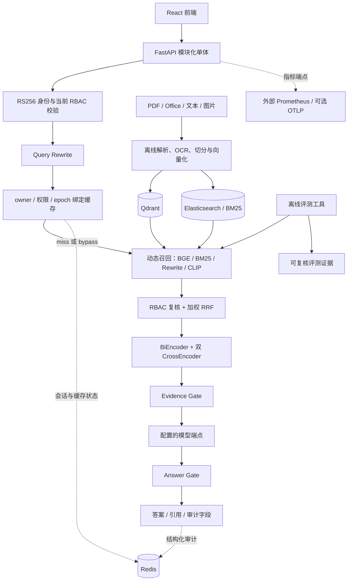

# Beauty Industry RAG QA System

**化妆品行业多模态 RAG 知识问答系统**

面向化妆品法规、成分与产品知识的多模态 RAG 参考实现，提供混合检索、证据约束问答、权限隔离和可复现评测工具。

[](https://github.com/Xander-Xai/Beauty-Industry-RAG-QA-System/actions/workflows/ci.yml)
[](https://github.com/Xander-Xai/Beauty-Industry-RAG-QA-System/actions/workflows/lint.yml)
[](https://github.com/Xander-Xai/Beauty-Industry-RAG-QA-System/actions/workflows/security.yml)
[](LICENSE)

[](https://github.com/Xander-Xai/Beauty-Industry-RAG-QA-System/releases)

**导航：** [Quick Start](#quick-start) · [架构](#架构) · [功能](#核心功能) · [评测](#评测) · [Synthetic Demo / 合成数据演示](docs/demo/README.md) · [部署](docs/deployment-guide.md) · [文档](docs/README.md) · [安全](SECURITY.md) · [贡献](CONTRIBUTING.md) · [版本记录](CHANGELOG.md)

## 项目简介

化妆品法规、成分和产品信息常分散在 PDF、表格与图片中。本项目展示如何将文档解析、检索、权限与模型生成组合为可检查的 RAG 工作流：答案须基于当前授权检索证据；证据不足时拒答；来源和知识版本可追踪。

它不同于只演示向量相似度的最小 Demo：仓库包含离线知识构建、BM25 与向量检索接线、动态召回和重排、Evidence/Answer Gate、RBAC、会话/缓存边界以及独立的评测和发布证据契约。当前 canonical 在线架构是 **FastAPI 模块化单体**。这是公开工程参考实现；代码或自动化测试通过不等同于生产部署验收。

应用入口为根目录 [`app.py`](app.py)。

示例和评测资产的来源、合成声明及使用边界见 [数据来源与公开边界](DATA_PROVENANCE.md)。本仓库不代表任何组织的官方产品，也不提供私有业务数据、凭据或生产部署服务。

## 核心功能

- **多模态知识工程：** 解析 PDF、DOCX、XLSX、文本及图片；OCR/CLIP 接口和资产路径可配置，真实模型 smoke 尚未完成。
- **离线构建与版本：** 文档切分、文本/图像向量化、Qdrant 与 Elasticsearch 写入、快照校验、epoch 封存；激活需人工操作。
- **混合检索与重排：** 在线动态 2–4 路召回、加权 RRF、BiEncoder 与双 CrossEncoder；真实 Dense/Hybrid/重排质量仍待外部模型和语料验证。
- **证据约束问答：** 生成前 Evidence Gate、生成后 Answer Gate、来源字段与拒答路径。它们是实现机制，不是法规事实核验或 prompt-injection 免疫证明。
- **权限与会话：** RS256 身份、role/dept 掩码 RBAC、权限和知识版本隔离、owner-scoped 会话与缓存约束；真实部署权限策略仍需验收。
- **模型路由与可观测：** 4B/14B 路由契约、指标/告警配置和可选 OTLP exporter；真实 GPU 拓扑与可观测闭环未验证。
- **评测与发布治理：** 检索/答案评测工具、来源审批与证据 manifest 契约、工业 profile 的 fail-closed 代码路径；真实工业发布验收未完成。

具体实现位置和证据等级以[架构基线](docs/architecture-baseline.md)及[证据地图](docs/evidence-map.md)为准。

## 架构

下图为当前实现的高层视图；细化链路、状态边界和证据等级见唯一的[架构事实基线](docs/architecture-baseline.md)。部署拓扑与实际运行状态见[部署指南](docs/deployment-guide.md)和[工业发布合同](docs/industrial-release-contract.md)。



图中模型、外部监控和数据存储是配置依赖；其真实模型推理、端到端联调和生产部署不由静态架构图证明。Kubernetes 清单为非 canonical 的静态部署契约，不代表已有集群运行。

## Quick Start

### 代码与自动化检查

要求 Python 3.11；前端构建另需 Node.js 20。此路径验证仓库代码，不会启动完整 RAG 服务：

```bash
python3.11 -m venv .venv
source .venv/bin/activate
python -m pip install -r requirements.txt -r requirements-dev.txt
python -m pytest tests/ -q
ruff check .
ruff format --check .
python scripts/check_repo_consistency.py
python scripts/check_public_repository_boundary.py
```

`requirements-dev.txt` supplies the shared pytest and Ruff toolchain used by local development and CI. It is not installed by the production Dockerfile. The demo uses a synthetic corpus and mock API; it demonstrates UI rendering only, not a real RAG backend run.

### 本地服务栈

Docker Compose v2 用于启动应用和 Redis、Qdrant、Elasticsearch、MinIO。Compose 启动本身不提供模型权重、已审批语料或用户身份；完整问答还需配置模型端点/资产、构建索引并配置有效认证。硬件需求取决于所选模型和推理方式，仓库不附带模型权重，也不提供可在纯 CPU 环境完成 RAG 的替代路径。

```bash
cp .env.example .env
export SERVICE_AUTH_TOKEN="$(openssl rand -hex 32)"
export REDIS_PASSWORD="$(openssl rand -hex 32)"
export ELASTICSEARCH_PASSWORD="$(openssl rand -hex 32)"
export MINIO_ACCESS_KEY="$(openssl rand -hex 12)"
export MINIO_SECRET_KEY="$(openssl rand -hex 32)"
docker compose up -d --build
curl --fail http://127.0.0.1:8000/api/health
```

API 文档默认位于 <http://127.0.0.1:8000/docs>。健康检查只报告应用/依赖状态，不证明模型推理或 RAG 查询成功。查询接口为 `POST /api/query`，请求体使用 `{"query":"...","session_id":"..."}`，并要求有效认证身份。完成身份、模型端点、active epoch 与可检索语料配置后，可用部署环境签发的 token 发起请求：

```bash
curl --fail http://127.0.0.1:8000/api/query \
  -H "Authorization: Bearer ${ACCESS_TOKEN}" \
  -H "Content-Type: application/json" \
  --data '{"query":"如何核对某原料的适用法规？","session_id":"quick-start"}'
```

此示例不附带有效 token 或法规结论；只有对应环境的实际响应可作为运行证据。

停止服务：`docker compose down`。此命令保留命名卷；仅在确认不再需要本地数据后，才使用 `docker compose down -v` 清理卷。

### Industrial Profile

Industrial Profile 是 fail-closed 的发布候选配置，不是更轻量的 Quick Start。它要求独立审定且与 active epoch、内容哈希、权限和适用日期匹配的发布清单、真实身份/依赖配置及外部模型服务。配置检查方式和禁止发布条件见[工业发布合同](docs/industrial-release-contract.md)；没有真实审定语料、模型和运行验收时不得启用为生产服务。

## 评测

- **框架：** 检索、答案与 RAGAS harness 由确定性测试覆盖；RAGAS 为 opt-in，不可用时严格命令 fail fast。
- RAGAS evaluator 或凭据不可用时，`--require-ragas` 以非零状态退出且不生成质量报告；缺失结果不作为零分。
- 检索评测框架为 `REPO_VERIFIED`；测量结果按范围分级。当前只有下述 BM25 结果属于 `LOCAL_REAL_VALIDATION`；Dense / Hybrid 结果仍为 `PENDING`。
- **已有测量：** Real Corpus V1 的 BM25：27 条具名签署样本、两份已审批来源、真实 Elasticsearch 8.11.0。指标、逐样本证据和限制见[正式运行报告](docs/validation/real-v1-approved-bm25-run.md)，可离线复算：

  ```bash
  python3 scripts/validation/verify_benchmark_evidence.py
  ```

- **未验证：** Dense / Hybrid、真实 BGE/CLIP/CrossEncoder 质量、RAGAS 质量分、真实 GPU 推理、完整浏览器端到端、生产负载及生产 SLO。旧版 301 条数据集没有可归因的稳定文档身份，不能据其宣称检索指标。
- **复现入口：** [评测指南](docs/ragas-evaluation-guide.md)、[评测就绪度](docs/validation/rag-eval-readiness.md)、[未执行运行时验证索引](docs/deferred-runtime-validation.md)。

## 状态与限制

| 证据层 | 当前边界 |
|---|---|
| 已实现并有确定性测试覆盖 | 模块化单体、检索/重排接口、Evidence/Answer Gate、RBAC、知识版本契约、评测工具和工业 release admission 代码 |
| 本地真实依赖验证 | 有限的 Redis、Qdrant、Elasticsearch、代理与 Prometheus 单机记录；不代表生产集群或 HA |
| 真实评测结果 | 当前公开结果限 Real Corpus V1 BM25 的指定数据、配置与环境 |
| 尚未验证 | Dense/Hybrid 与重排质量、RAGAS、真实模型/GPU、浏览器端到端、Kubernetes、性能/可观测闭环和工业生产验收 |

逐能力证据与最新验证记录分别见[证据地图](docs/evidence-map.md)、[验证索引](docs/deferred-runtime-validation.md)及 GitHub [Actions](https://github.com/Xander-Xai/Beauty-Industry-RAG-QA-System/actions)。外部模型、人工法规审阅、授权数据、GPU 和部署环境缺失时，相关任务保持未验证。

The Kubernetes manifests have 31 static checks in `tests/deploy/test_k8s_manifests.py`; these are static contract checks only and do not prove a real cluster deployment.

## 项目演示（合成数据）

仓库提供一份可复现的**合成数据演示**：真实前端配合 `docs/demo/mock_api.py` 夹具渲染问答、引用与权限拒答流程。演示语料为人工构造，图中延迟、门禁分数与掩码值均为**合成示例**，**不是真实生产运行结果，也不构成真实 RAG 端到端证据**。生成方式、权限对照与复现步骤见 [演示图生成说明](docs/demo/README.md)。

## 文档与社区

- [文档总览](docs/README.md) · [架构基线](docs/architecture-baseline.md) · [配置入口](config.json) / [环境变量模板](.env.example)
- [部署指南](docs/deployment-guide.md) · [评测指南](docs/ragas-evaluation-guide.md) · [证据地图](docs/evidence-map.md)
- [安全政策](SECURITY.md) · [贡献指南](CONTRIBUTING.md) · [支持与问题反馈](SUPPORT.md)
- [变更记录](CHANGELOG.md) · [GitHub Releases](https://github.com/Xander-Xai/Beauty-Industry-RAG-QA-System/releases)

成熟开源项目 README 的实际参考与本仓采用范围记录于[项目参考笔记](docs/open-source-project-references-2026-11-25.md)。

## 版本与许可

Runtime 版本由 `config.json` 的 `system.version` 管理，当前为 `2.4.0`；GitHub 最新正式 Release 为 `v2.4.0`。本轮文档与仓库治理不改变运行时/API 版本，未满足发布新版本的依据。详见 [CHANGELOG](CHANGELOG.md)。许可证为 [MIT](LICENSE)。
