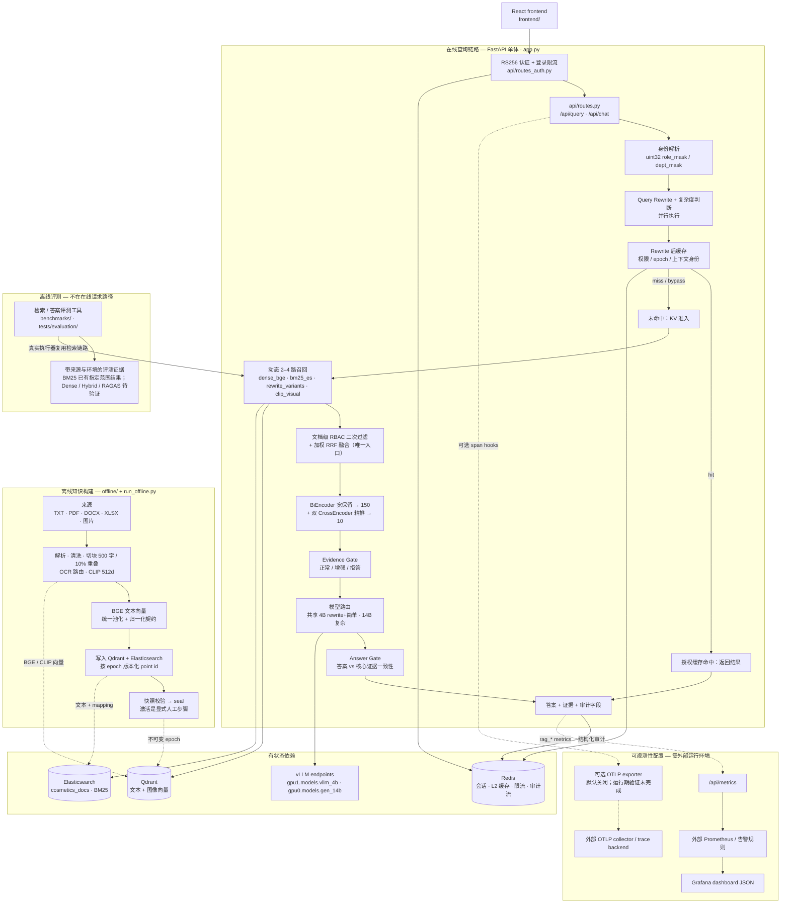

# 化妆品知识问答系统架构基线

**工业治理基线**：[工业发布合同](industrial-release-contract.md) 已随 PR #161 合入主线，描述 fail-closed 发布准入实现及其验收边界；这不代表真实工业数据审定或生产部署已完成。#155 排序实验入口也已合入主线，但排序收益裁决仍等待真实资产与匹配语料评测。保留离线 OCR/CLIP + 在线按需视觉召回；工业模式禁用无独立审定的 BLIP 实时内容注入和裸图片路径。

更新时间：2026-11-26（工业发布主线状态复核；canonical 架构图收敛到本文件，README 仅保留第一屏简化视图）

本文件是“整体架构”“几路召回”“如何重排”“如何控制幻觉”等架构问题的唯一事实基线。README、PRD、代码注释和历史表述稿发生冲突时，以当前主链路代码、配置和架构契约测试为准。

## Architecture decision freeze — 2026-11-25

**主架构：离线多模态知识构建 + 在线 FastAPI 模块化单体 RAG。** 本仓主责检索、证据、权限和知识发布，不引入通用 Agent Loop、MCP/A2A、执行沙箱或跨任务用户画像。本公开参考实现的工程治理不构成任何第三方生产上线证明。

| 设计 | 裁决 | 边界 / 验收 |
|---|---|---|
| 单体 + Qdrant + Elasticsearch + Redis | 保留为唯一在线主线 | 微服务目录及 K8s 为非主线可选实验，不扩张；只有独立扩容/故障隔离的实测需求才重新评审 |
| 动态 2–4 路检索 + RRF | 保留 | CLIP 仅视觉需要；Rewrite 变体仅复杂查询；fallback 不算第五路 |
| Rewrite 与缓存 | 先 Rewrite 再缓存读取 | requires_context、owner/session、对话指纹、权限及 epoch 必须绑定；不合格绕过缓存 |
| BiEncoder + 双 CE | 当前实现保留，架构待裁决 | 目标候选为 Hybrid + 单 CE；同一语料、候选深度、权限、模型资产比较 hybrid、BiEncoder、单 CE、双 CE；以 Recall/MRR/NDCG、关键法规漏召回、延迟/资源共同决定；不得提前宣称精简已交付 |
| Evidence/Answer Gate | 保留 | NLI 是证据一致性信号，不是法规真实性证明；来源、时效、适用条件、拒答必须验证 |
| 4B/14B 路由与双 GPU | 保留配置，不承诺物理拓扑 | 实测前不能证明吞吐收益；共享 rewrite/生成资源须检查排队、超时和隔离；仅在实测容量或隔离需求成立时增加 GPU 服务 |
| RBAC/epoch | 保留纵深防御 | 检索前过滤、融合后复核、上下文缓存隔离；uint32 是现有组织约束，不宣称任意规模 ABAC |
| 后端 fallback | 保留显式降级 | 成功空结果与权限过滤不算故障；实际召回/RRF/fallback 执行失败通过请求级降级状态暴露并绕过答案缓存写入；不能把失败当命中或当完整评测 |

**资源所有权整改**：默认 `embedding.text.model_path` 与 `gpu1.models.bi_encoder.model_path` 均为同一 BGE 路径；在线 Pipeline 通过依赖注入复用其 EmbeddingService，而不是让 BiEncoder 持有另一套同权重实例。独立调用和不同专用 BiEncoder 路径仍受原契约约束。此处只消除重复服务对象，不移除候选重新评分，不宣称实际 GPU 内存、吞吐或延迟收益已经测量。

**架构裁剪门禁**：先冻结同语料及独立金标，比较简单基线和复杂模块；缺真实模型资产时不删除当前门控或修改分数阈值。保留安全默认和兼容接口，修改排序必须验证拒答和 Answer Gate，CI 与真实评测分别报告。现有 27 样本 BM25 结果不是 Dense/Hybrid/Rerank/RAGAS 的验收。架构裁决先于新增能力；历史审计不回填。

### 排序裁决与冻结条件（#154）

当前在线链路仍为加权 RRF → BiEncoder → 双 CE。目标候选优先比较加权 RRF → 单 CE（A/B 分别测试），不是已经替换的实现。必须同时比较去掉 BiEncoder 的单 CE / 双 CE、保留 BiEncoder 的单 CE / 双 CE 和无精排基线，避免把多个变量混在一起而误判收益。

同一独立相关性金标、授权语料、权限过滤、召回候选深度、模型资产和运行环境；分别报告关键法规漏召回、Recall@K、MRR/NDCG、P95、失败率及资源使用。质量阈值、拒答策略和延迟预算在实验前冻结；无有效实测结果则保持现有线上排序与门控，不因 fixture 通过而删减安全机制。

#155/#156 是重叠的排序实验实现，不能独立合并并重复定义配置。合并前检查配置矩阵、单模型真实推理、资产收据、完整样本和默认链路回归。真实 BGE/CE 权重或授权语料缺失时，排序裁决保持 BLOCKED。

**分数方向缺陷（#155 CI）**：旧默认 `sigmoid(-s)` 将更高的 CE 相关性分数映射成更低置信分，造成已知固定评分样本排序反转。修复冷启动为 `sigmoid(+s)`；显式配置的校准系数仍保留其语义。此处是分数方向修复，不是已拟合概率，也不意味着改变在线精排拓扑。使用真实 CE-A/CE-B 资产前必须核实其输出语义与可比性、在独立标注集上拟合校准并重新验收 Evidence/Answer Gate（尤其法规拒答）；禁止根据未校准分数声称生产可信。在线缓存键增加 ranking policy 版本和检索配置，避免旧反向评分产生的缓存答案跨版本复用。此阶段不扩展部署拓扑或 Agent 功能。

## 一句话结论

当前已验证架构是 FastAPI 单体主链路，不是已完成联调的微服务架构；在线检索采用动态 2 至 4 路召回，而不是固定四路：

- 简单问题：BGE-Dense + BM25，共 2 路。
- 复杂但不需要视觉信息的问题：BGE-Dense + BM25 + Rewrite 变体，共 3 路。
- 复杂且需要视觉信息的问题：BGE-Dense + BM25 + CLIP + Rewrite 变体，共 4 路。

ES Fallback 不算第五路。它是 Qdrant 异常或有效文档不足时使用的降级补召回；异步 CLIP 也不是新的一路，而是同一视觉检索能力对后续会话的预热。

## 事实等级

本节的等级就是 [Evidence map → Classification vocabulary](evidence-map.md#classification-vocabulary)
中的 canonical evidence vocabulary，本文件不另立一套状态词。下面只补充每个等级在当前主链路里的表述口径。

| 等级 | 在当前主链路中的含义 | 表述口径 |
|---|---|---|
| `REPO_VERIFIED` | 已接入 `app.py -> api/routes.py -> core/pipeline.py`，有实现和契约测试 | 可以说“当前系统采用” |
| `REPO_VERIFIED`（实现）/ `PENDING`（真实资产） | 有实现和契约测试，但需要真实基础设施、模型权重进一步验收 | 可以说“系统已实现，生产效果需部署验收” |
| `REPO_VERIFIED`（可选能力，未接入主链路） | 代码或配置存在，但当前默认未开启或未接入主链路 | 只能说“支持”或“预留” |
| `PENDING` | 缺少有效运行结果或生产数据 | 不能说“已经上线验证” |

## 当前主链路

下图是**唯一 canonical 架构图**。README 的第一屏只放它的简化在线视图；其他文档引用本图，不再各自维护独立的大型架构图。



读图约定：`CACHE`/`AUTH`/`OUT` 指向 Redis 的边表示**状态依赖**（会话、L2 缓存、限流计数、审计流），不是独立服务调用；`OUT` 的 `rag_* metrics` 只落在 `MetricsCollector` 并由 `/api/metrics` 暴露给外部 Prometheus，不写入 Qdrant/Elasticsearch/vLLM。Prometheus、Grafana 与 OTLP backend 是外部/可选依赖；此图不表示它们在本仓库中默认运行或已完成闭环。评测工具为离线路径，只有显式 benchmark 执行器会调用真实检索代码。`OFFLINE` 到存储的虚线表示**离线写入**方向，与在线召回互不依赖。`vLLM endpoints` 是配置里的两个端点键，其真实 GPU 部署为 `PENDING`。`/api/continuation` 明确返回 HTTP 501 `Not Implemented`，前端不调用且不属于当前业务链路（见 [user guide](user-guide.md)）。

默认联调入口是 FastAPI 单体后端和 React 前端。仓库中的微服务目录（`api-gateway/`、`retrieval-service/`、`generation-service/`、`monitoring-service/`、`cache-service/`、`rewrite-service/`）属于保留能力，尚不能替代当前单体主线来回答“现有系统架构”，也不代表已与当前前端完成端到端生产验证。

## 离线知识构建

离线侧将文档和图片加工成统一知识资产：

1. 文档解析、清洗、切分并补充来源、业务类型、状态、知识版本和权限掩码。
2. 图片执行 OCR 文本提取和 CLIP 图像向量化。
3. BGE 文本向量与 CLIP 图像向量写入 Qdrant，文本内容写入 Elasticsearch。
4. 调度器通过文件状态和内容哈希支持增量更新，并支持显式切换知识版本。

BLIP 不应描述为固定的离线建库步骤。当前主链路是在视觉查询命中图像结果后在线按需生成描述；模型或权重不可用时跳过。

## 在线检索与权限

四个可选召回路径分别是：

| 路径 | 存储与模型 | 触发条件 |
|---|---|---|
| `dense_bge` | BGE + Qdrant 文本集合 | 所有问题 |
| `bm25_es` | BM25 + Elasticsearch | 所有问题 |
| `clip_visual` | CLIP + Qdrant 图像集合 | 复杂问题中被视觉判别器选中的请求 |
| `rewrite_variants` | Query Rewrite 变体 + BGE + Qdrant | 复杂问题 |

路径名在三个地方必须逐字一致：`config.json` → `retrieval.parallel_paths` 的拓扑键、
`retrieval/parallel_recall.py` 注册进 `path_results` 的键、以及 `core/pipeline.py`
的 `_build_rrf_weights()` 产出的权重键。`tests/test_architecture_contract.py` 对三者做一致性断言。

结果通过加权 RRF 融合，**融合只有这一个入口**：`retrieval/parallel_recall.py` 的
`execute()` 里的 `rrf_fusion`（`k` 取自 `retrieval.rrf.k`）。查询感知权重由
`core/pipeline.py` 的 `_build_rrf_weights()` 产生并直接交给它消费：法规问题 BM25 提到 1.5，
视觉相关问题 CLIP 提到 2.0；配置里的 `w_text`、`w_clip` 别名映射到实际路径名。融合之后
`core/pipeline.py` 的 `_union_dedup()` 只做去重（折叠 ES Fallback 追加的补召回），
不重算分数、不重排。

融合与去重这一步之后，任何一层都不得再引入第二套融合权重或重打分；下一步的 BiEncoder 与
双 CrossEncoder 按自己的分数重排是重排层的职责，不是融合。这条边界由
`test_query_aware_weights_survive_the_whole_online_path` 断言。

权限采用双层控制：

- Qdrant 下推文档状态；显式启用知识版本后同时下推版本条件。
- Elasticsearch 下推状态、知识版本、角色和部门过滤。
- 所有召回适配器保留角色和部门元数据，融合前统一通过位掩码 RBAC 二次过滤。
- ES Fallback 复用正常 BM25 的权限查询，不能绕过权限。
- 缓存键包含知识版本、权限指纹、排序策略版本和检索配置，公开数据才进入进程内 L1，其他权限组合使用 Redis L2。法规问答、带图片请求、具有运行时 A/B 覆盖的请求及已标记降级的请求绕过回答缓存；显式 CE fallback 不写缓存。文本键没有图像内容指纹或实验分组身份，不允许共享缓存污染多模态回答及 A/B 对照。真实分数校准、模型内容版本和未标记的降级仍需专项验收。

## 重排、证据门控与生成

RRF 融合与去重之后，先由 BiEncoder 宽保留 Top 150，再由两个 CrossEncoder 集成精排到 Top 10。当前在线调用使用请求内批量预测；跨请求异步聚合接口虽然存在，但没有接入这条主调用，因此不要声称“当前主链路已经完成跨请求动态微批”。

生成前的 Evidence Gate 综合以下四项：

- CrossEncoder Top 1 分数；
- Top 3 平均分；
- 多路召回一致性；
- Top 3 文档间一致性。

它给出正常生成、增强证据后生成或拒答三种决策，是真正 fail closed 的一道。生成后的 Answer Gate 再检查答案与核心证据的一致性，但**只有法规类**在矛盾时拒答：低相似度快速路径的判定是 `passed = not is_regulation`，所以非法规类在同样的低相似度下是带 warning 通过，不是拒答。

生成拓扑当前是**单一共享 4B vLLM 端点**（`gpu1.models.vllm_4b`，端口 8101）：Query Rewrite 与简单生成共用 `gen_4b`，复杂请求走 `gen_14b`（Qwen3-14B）。旧 PRD 中“独立的 vLLM-Rewrite + vLLM-Gen-4B 双实例”是历史/目标设计，不是当前实现。KV 压力过高时可以截断、降级或拒绝。当前 `development` 配置会把复杂模型端点降级到 4B，且仓库不包含完整模型权重，因此“双模型已完成生产压测”不属于当前事实。

## v2.5 运行时与安全契约

> **版本语义**：`v2.5` 是本节契约的历史 working milestone / development-phase 标签，**不是**正式发布版本。当前 canonical runtime version 为 `config.json` → `system.version` = `2.4.0`；`CHANGELOG.md` 中最新一条 dated release entry 为 `2.4.0`（2026-10-08），其后的变更记在 `[Unreleased]`。`docs/repository-truth-audit.md` 与 `docs/repository-drift-report.md` 中的 `2.3.0` 是它们各自核对日期上的**时间点快照**，不是当前版本声明。当前 GitHub Release / tag 状态以仓库实际状态为准，详见[版本策略](repository-truth-audit.md#version-policy)。

- **会话状态**：`SessionState` 在配置 Redis 时跨 worker 持久化（TTL 7200s），Redis 不可用时降级进程内内存。序列化使用稳定 schema，`QueryRewriteResult`/`RecallResult` 会重建。真实 Redis 多进程行为已在本地完成 `LOCAL_REAL_VALIDATION`（写入进程 A、进程 B 类型化恢复、进程 C 观察到更新、TTL 刷新）；Redis Cluster/Sentinel 生产拓扑仍属外部验证边界。
- **登录限流**：5 次/分钟；多 worker 走 Redis 计数，Redis 不可用降级单进程内存。仅当 TCP 对端属于 `TRUSTED_PROXIES` 时才信任 `X-Forwarded-For`，否则客户端伪造 XFF 无法绕过限流。真实 Redis 跨进程限流与真实 nginx 反向代理客户端 IP 解析均已完成 `LOCAL_REAL_VALIDATION`。
- **可观测端点**：`GET /api/stats` 与 `GET /api/metrics` 需要认证（`require_identity`）；`GET /api/health` 公开。Prometheus 抓取需 Bearer token；本地已用真实 Prometheus 完成认证抓取验证（无 token 401、Bearer 200、target `up == 1`）。
- **Elasticsearch 安全**：Compose 启用 `xpack.security.enabled=true`，在线/离线客户端优先读取环境凭据；本地已用真实认证 ES 8.11 验证（匿名/错误凭据 401、writer mapping + `search_after`、在线 BM25 检索）。
- **知识版本激活**：构建/校验/封存可自动化，但**激活 `knowledge_version_epoch` 是显式人工发布步骤**，没有自动 activation。
- **本地真实验证等级（LOCAL_REAL_VALIDATION）**：上述 Redis 多进程、nginx / `TRUSTED_PROXIES`、认证 ES、认证 Prometheus 抓取均已在本地真实依赖上执行，证据见 [v2.5 working-milestone runtime/security validation](validation/v2.5-runtime-security-validation.md)。这**不等于**生产集群验证。
- **仍属外部验证边界**：Redis Cluster/Sentinel 生产拓扑、云负载均衡拓扑、多节点 ES/TLS、长期 Prometheus/Grafana 运维、生产 HA/SLO，以及单 4B / 14B vLLM GPU 部署，均未在本仓库验证。

## 可观测性与评测边界

最重要的一句区分：**「实现了」不等于「生产验证过」**。下面按 canonical 证据等级分层，不要跨层表述。

### REPO_VERIFIED（本仓库代码 + 确定性测试覆盖）

| 能力 | 实现位置 | 说明 |
|---|---|---|
| Prometheus 指标端点 | `api/routes.py` → `monitoring/otel_tracer.py::MetricsCollector` | `/api/metrics` 暴露 `rag_*` series；`/api/stats` 暴露计算字段 |
| 结构化企业动作审计 | `common/audit.py` | 统一 9 字段 schema、强制脱敏、request_id 关联、Redis Stream + 每日 JSONL |
| 性能产物框架 | `benchmarks/performance.py`、`artifacts/performance/` | 七文件契约；未测量即 `null`，绝不写 `0`；状态由实际观测推导 |
| Prometheus 告警规则 | `monitoring/prometheus/alerts.yml` | 6 条规则，只引用真实 emit 的 series |
| Grafana 仪表盘 JSON | `monitoring/grafana/dashboards/rag-overview.json` | 10 个面板，只用真实指标 |
| SLO 与故障 Runbook | `docs/slo-runbook.md` | 5 个目标 + 11 个处置流程，按代码中真实存在的降级路径编写 |
| OTLP exporter 实现 | `monitoring/otel_exporter.py` | 可选启用、失败不影响业务、span 属性白名单 |

### LOCAL_REAL_VALIDATION（本地单主机、真实依赖上跑过）

只有这六项，不要扩大：

- Redis 多进程会话持久化
- Redis 跨进程登录限流
- nginx / `TRUSTED_PROXIES` 反向代理客户端 IP 解析
- 认证 Elasticsearch（在线 BM25 + 离线 writer）
- 带 Bearer token 的 Prometheus 抓取（无 token 401 / Bearer 200 / target `up == 1`）
- 真实 Qdrant 单主机服务（epoch point id / payload 过滤 / RBAC 重过滤 / 缓存键隔离；
  `VAL-STORE-001`，由已提交的 `artifacts/qdrant/2026-10-09-qdrant-v1.12.0/` 提升，
  **确定性向量，不构成 BGE/CLIP 模型质量证据**）

### DESIGN_TARGET（写进文档的目标值，没有任何实测支撑）

- SLO 全部目标值（99.5% / <1% / ≤2000ms / ≥99% / 100%）
- Prometheus 告警阈值（6 条规则里的每一个数字）
- 容量阈值（例如 `RagRequestSaturation` 的在途请求上限 50）
- PRD 的 P95≈2s / P99≤3s / QPS 12–18 —— 均为推导模型，不是实测

### PENDING（代码在，但缺的资产/凭据/运行记录在这里拿不到）

- **OTLP 运行期闭环 — PENDING**：应用 → exporter → collector → 后端 → 查到 span 这条链路没有任何运行记录；exporter 已实现且默认关闭
- 真实性能产物 — PENDING：仓库内没有 artifact，因此 QPS/P95/P99 一次都没测过
- 告警在生产触发 — PENDING：规则存在，但没有任何生产 Prometheus 评估过它们
- Grafana 面板被真实数据填充 — PENDING：JSON 从未导入过运行中的 Grafana
- 真实 RAGAS 质量结果 — PENDING：无获批 evaluator 凭据
- 真实 4B/14B vLLM GPU 拓扑 — PENDING：权重不在仓库，`vllm` 未安装
- 真实检索 benchmark 结果 — **Real Corpus V1 的 BM25 已产出**（`LOCAL_REAL_VALIDATION`：27 条具名签署金标、全审批语料、真实 ES 8.11.0、逐样本证据可离线复算，见 `docs/validation/real-v1-approved-bm25-run.md`）；Dense / Hybrid 与旧版 301 条数据集仍 `PENDING`
- 真实 BGE / CLIP / PaddleOCR smoke — PENDING：`EXTERNAL_MODEL_ASSET_REQUIRED`

### 追踪钩子的准确说法

追踪钩子在主链路（`core/pipeline.py` → `monitoring/otel_tracer.py`），默认走 OpenTelemetry SDK
`TracerProvider`；只有 OTel SDK 未安装或 provider 初始化失败时，才退回本地内存 span 模式。
导出是**已实现但默认关闭**的可选能力：`OTEL_EXPORT_ENABLED=false` 时不挂载
任何 span processor，span 既不导出也不保留；exporter 包本身是 `requirements-otel.txt` 里的
可选依赖。导出是否生效可以看 `rag_otel_exporter_enabled`。

所以只能说：**「追踪钩子已接入，OTLP exporter 已实现且默认关闭，运行期闭环是 PENDING」**。
不能说「OpenTelemetry/Jaeger 导出已闭环」「tracing 已验证」「Jaeger 已上线」——
本仓库没有任何一个 span 被后端查询到过。旧 PRD / 旧计划里的 Jaeger thrift agent 路径
已经移除：它从未有过 canonical 消费者，当前 exporter 走 OTLP，不走 Jaeger agent。

### 两套告警机制不要混淆

- **正式告警契约**：`monitoring/prometheus/alerts.yml`，由外部 Prometheus 加载评估。
- **`monitoring/otel_tracer.py::AlertingManager`**：更早的进程内阈值引擎，**没有**接入
  canonical 请求路径，`config.json` 里喂它的 `alerting.rules` 配置块也已移除。它是遗留代码，
  不是 Prometheus 规则的一部分，不要把它当作告警机制。

### 评测

RAGAS harness / reporter / validator 与 Golden Set 已存在：最初 seed 27 条，现 300+ 条，实际条数以
`validate_golden_set` 输出为准。**格式校验通过 ≠ 领域事实正确**。

RAGAS 是隔离的可选 evaluator，不在默认依赖中。未获准入时，库级 `evaluate()` 返回 evaluator-unavailable fallback（该结果不是质量结果）且不导入/调用 evaluator。当 evaluator 依赖不可用或 evaluator 凭据缺失时，`--require-ragas` 以非零状态退出（退出码 2/3/8），并且不生成任何质量报告；其中未获安全准入为 8。截至 2026-11-25，候选依赖因无修复版的 diskcache `CVE-2025-69872` 未获准入，真实 RAGAS 评测保持禁用。当前没有经过验证的真实 RAGAS quality score；没有生产反馈数据时，不应声称阈值已经由线上反馈自动学习或每周稳定更新。

## 标准架构说明

本项目可以概括为一套多模态知识底座、离线知识构建和在线 RAG 问答两条核心链路，再加上权限、安全与可观测性保障。

离线侧负责解析、清洗和切分法规、配方、原料、产品文档，并为图片执行 OCR 和 CLIP 向量化。BGE 文本向量与 CLIP 图像向量写入 Qdrant，文本同步写入 Elasticsearch 支持 BM25；每个知识块都带来源、状态、知识版本以及角色和部门权限掩码，调度器通过文件状态和内容哈希支持增量更新。BLIP 是在线视觉结果命中后的按需增强，不是固定离线步骤。

在线侧由 FastAPI 接收请求，先解析身份，再并行执行 Query Rewrite 与复杂度判断。随后按改写结果、知识版本、权限指纹和上下文身份读取 L1/L2 缓存；缓存未命中或被绕过时才进入召回。检索不是固定四路，而是动态 2 至 4 路：简单问题走 BGE 和 BM25；复杂问题增加 Rewrite 变体；复杂且视觉相关时再增加 CLIP。多路结果先经过文档级 RBAC 二次过滤，再使用动态加权 RRF 融合。ES Fallback 是召回不足或 Qdrant 异常时的降级策略，不算第五路。

融合结果经过 BiEncoder 宽保留和双 CrossEncoder 精排。生成前，Evidence Gate 综合 Top 1、Top 3、多路一致性和文档间一致性，决定正常生成、增强证据生成或拒答；生成后，Answer Gate 再校验答案是否忠于核心证据，法规类矛盾会直接拒答。

生成层使用单一共享 4B vLLM 端点处理 Query Rewrite 与简单生成，复杂请求路由到 Qwen3-14B，并结合 KV 压力做截断、降级或拒绝。

工程侧分三层，因为这三层的证据强度不一样。**已实现并有测试覆盖**的是：指标端点、结构化业务动作审计、性能产物契约、Prometheus 告警规则、Grafana 仪表盘 JSON、SLO 与故障 Runbook，以及一个默认关闭的 OTLP exporter。**在本地真实依赖上验证过**的只有 Redis 多进程、nginx 代理信任、认证 Elasticsearch 和认证 Prometheus 抓取。**还没有证据**的是：真实性能数字、告警在生产触发、Grafana 面板被真实数据填充，以及 exporter 到 collector 到后端再查到 span 的完整闭环——这个闭环一次都没跑通过，所以只能说 exporter 已实现，不能说 tracing 已闭环。另外 `config.json` 里的延迟和 QPS 目标值是设计目标，不是实测。

一句话总结：这是一套以 Qdrant 和 Elasticsearch 为多模态知识底座、以动态 2 至 4 路召回和两级重排保障检索质量、以双层 Gate 和 RBAC保障可信与权限安全的企业内部 RAG 系统；运维证据闭环已经建好，但真实运行数据还需要在部署环境补齐。

## 防止答案再次漂移

每次修改召回、权限、路由或评测配置后，至少执行：

```bash
pytest -q tests/test_architecture_contract.py
python3 -m tests.evaluation.validate_golden_set \
  --dataset tests/evaluation/golden_set.jsonl
```

表述稿只从本文件复制。新增能力必须先接入当前主链路并补充契约测试，再把表述从“支持”升级为“当前采用”。


### 排序架构消融（离线专用）

在已有严格五臂基础上，`python -m benchmarks.strict_retrieval_suite --dataset <reviewed.jsonl> --output-dir <new-dir> --architecture-ablation` 增加五个候选：Hybrid+单 CE-A / 单 CE-B / 双 CE（无 BiEncoder），以及 Hybrid+BiEncoder+单 CE-A / 单 CE-B。每条混合路径召回深度一致，CE 候选上限 150。单 CE 使用自身 tokenizer 的 pair 截断、配置内的同步分批推理与独立原始排序分（ce_score_a/b），复用同一模型实例，不创建每查询后台聚合线程；与现有双 CE 的 CE-A 预截断和集成校准不同，因此比较的是完整候选链路，不是严格只改变模型个数的因果实验。不得把原始分直接接入线上 Evidence Gate。

默认线上正常推理排序、阈值、旧五臂 CLI 不变；异常 CE 推理现在显式拒答（见下文），不是排序裁剪。严格模式要求真实模型资产、数据来源批准、完整样本和可发布证据；本次仅增加实验入口，真实模型消融仍待执行。没有真实对照证据前不得裁剪现有阶段。延迟仅使用实际记录的总检索时间，未测分阶段耗时不得填造。


线上 CE 失败边界（待 CI）：两路模型输出均使用严格推理校验；长度、有限性及校准分范围全部通过后才发布分数。推理异常、缺分或非法分进入显式 deterministic_fallback，保留诊断候选但 Evidence Gate 接收空证据并拒答，不把失败填零后校准为正常置信度。此变更不调整已配置校准参数，也不证明其校准质量。

**#154 裁决状态：BLOCKED（真实排序收益未测）。** 通过 fixture 或 CI 只能验收候选实验入口与失败契约，不能关闭排序裁决。运行前冻结业务批准的漏召回容忍度、质量非劣界、延迟预算与资产指纹；以同一批逐查询结果比较默认链路和各候选，分别报告关键法规失败、拒答变化、实际 GPU 峰值显存及 P95。未取得可信配对结果前不改线上模型数、候选深度或门控阈值；也不将 #156 重叠实验入口另行合并。

**Evidence Gate 状态归属**：共享 Pipeline 允许复用模型对象，但 NLI 降级标记是单次同步 evaluate 的线程局部状态，每次调用重置。并发请求不能覆盖其他请求的失败状态；此处保留原评分及阈值，不宣称真实 NLI 或模型效果已验证。新增双线程屏障回归测试。
